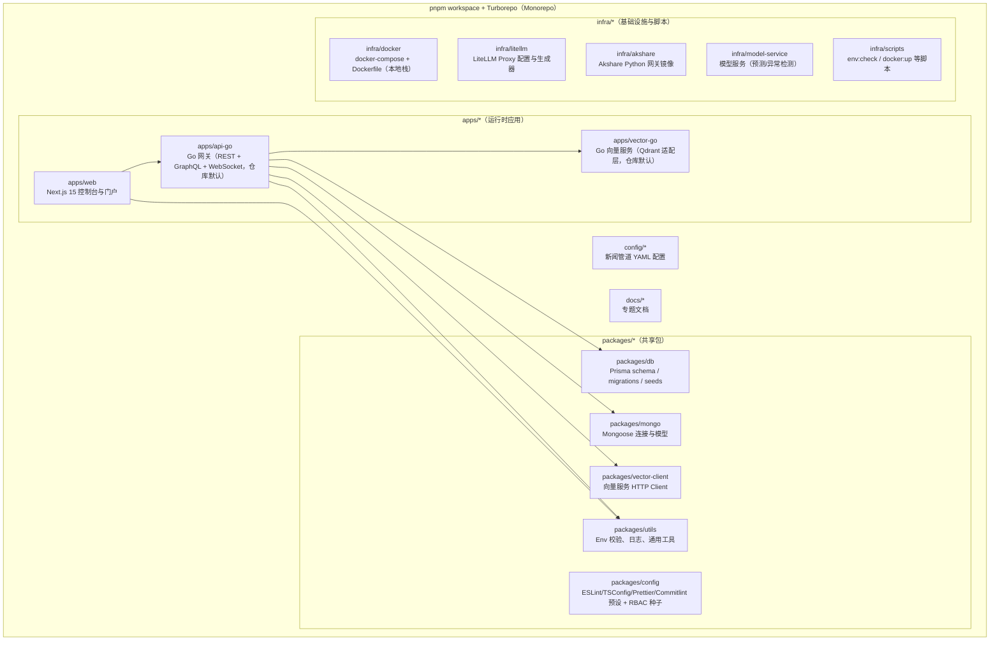
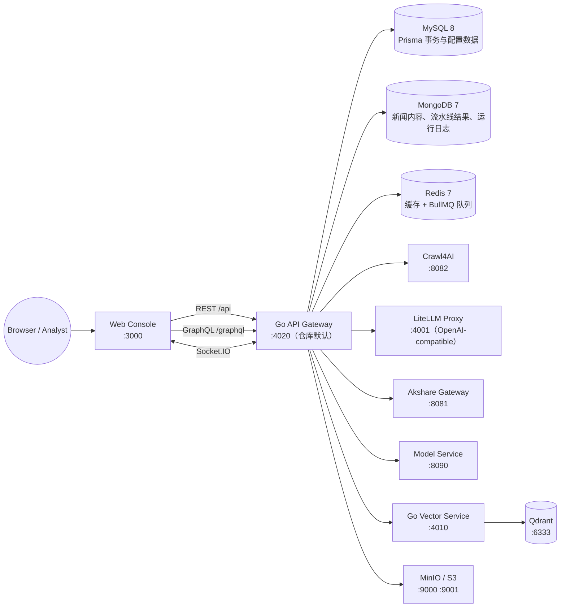

# Modular Monolith（全球态势感知与新闻情报分析平台）

一句话定位：一个面向组织的全球态势感知与新闻情报分析平台，通过“采集 → 清洗 → 结构化 → 关联 → 检索 → 可视化 → 实时推送”闭环，把新闻与事件数据转化为可查询、可解释、可运营的情报资产。

核心价值主张：

- 将多源新闻聚合、抓取与 LLM 清洗流水线整合为统一管道
- 将事件、实体、关系与影响链沉淀为知识图谱与影响分析
- 提供面向运营与分析的控制台、实时信号与可视化看板

## 目录

- [系统架构](#系统架构)
- [功能特性](#功能特性)
- [采集策略](#采集策略)
- [技术栈与选型理由](#技术栈与选型理由)
- [快速开始](#快速开始)
- [常用命令](#常用命令)
- [项目结构](#项目结构)
- [配置指南](#配置指南)
- [AIS Relay](#ais-relay)
- [并发控制说明](#并发控制说明)
- [API 文档入口](#api-文档入口)
- [开发规范](#开发规范)
- [部署与运维](#部署与运维)
- [贡献指南](#贡献指南)
- [更新日志](#更新日志)
- [开源复用声明（NewsNow）](#开源复用声明newsnow)

## 系统架构

### Monorepo 结构图



### 运行时组件图（本地 Docker Compose 默认）



> 仓库已移除 NestJS `apps/api`、Node `apps/vector` 与 Node `apps/ais-relay`。默认与唯一的运行时链即 `apps/api-go`（REST + GraphQL + WebSocket + worker）+ `apps/vector-go` + `apps/web`，AIS relay 由 `apps/api-go/cmd/ais-relay` 提供。回退旧后端依靠正常版本回滚，不再保留并行 Node 服务。

## 功能特性

以下能力均可在代码中对应到 `apps/api-go/cmd/api`（唯一后端）与 `apps/web/app/*` 的实现。

### 📊 新闻管道系统（采集、清洗、结构化、去重）

- 新闻源聚合与预置源：`news-aggregator`（多站点适配器 + NewsNow 实时分发）
- 抓取编排与结果存档：`crawl`（任务、重试、质量指标、媒体抓取、OPML/RSS 工具链）
- LLM 清洗与结构化：`news-pipeline`（LiteLLM OpenAI-compatible 接口，支持摘要、要点、主题、实体等结构化产物）
- 语义去重与检索：对接 `apps/vector-go`（Qdrant）；向量回填等一次性工具由 Go 侧/共享 Mongo 工具承担，Node `vector:backfill` 已随 `apps/api` 退役

## 采集策略

### Seed-first + LLM-assisted Frontier

新闻采集默认采用 `Seed-first, Frontier-second, LLM-adaptive` 双通道策略：

- 大站优先走 `robots.txt -> news sitemap / sitemap index -> sitemap common paths`，先拿高价值文章种子，再进入正文抓取。
- 同时保留轻量 `home/category/list` 拓扑通道，用于栏目学习、站点漂移检测、导航 lineage 和 DOM scope 自学习。
- 当 sitemap 不可用、质量差、或站点结构漂移时，系统自动回退到 `LLM-assisted frontier V1`，通过 `rule -> rerank -> LLM judge` 自适应识别 `home/category/list/article`。

这意味着系统并不依赖单一策略：

- `Reuters / Arc CMS` 这类大站，优先从 `robots.txt` 暴露的 `news-sitemap-index` 获取新闻文章，再用 frontier 做结构校验和补充。
- `BBC / Guardian / AP / Al Jazeera` 这类开放门户，可以同时利用 seed 与 frontier，降低纯 deep crawl 成本并保留栏目结构发现。
- 小站、国别门户、无 sitemap 站点、结构漂移站、反爬重站，`LLM-assisted frontier V1` 会成为主路径；即使没有标准列表页，也允许 `synthetic list` 语义来维持四层导航与文章发现。

实现约束也保持清晰：

- 与 Crawl4AI 的交互仍然是 `HTTP REST /crawl`，不直接调用 Python SDK。
- Crawl 阶段禁止 LLM extraction；LLM 只用于 frontier 判别、站点学习、以及 post-crawl 抽取修复。
- `news-source` 的 `sitemap/rss/list/deep` 种子发现，与 `crawl-frontier` 的 layered/native/hybrid 运行共享同一套去重、诊断和 profile 学习逻辑。

### 🌍 态势监控（全球事件追踪与可视化）

- 态势洞察聚合：`situation-monitor`（分类、叙事模式、相关性、主角实体、告警关键词等）
- 外部数据兜底与翻译：支持 GDELT 兜底与翻译 API（见 `SITUATION_MONITOR_*` 配置）；本地 Docker/WSL 下的 GDELT IPv4 兼容兜底说明见 [docs/gdelt-ipv4-fallback.md](./docs/gdelt-ipv4-fallback.md)
- 地理与地图图层：`geo`、`dashboard`（含世界地图资产与传播/时空热力相关图表服务）

### 🧠 知识图谱（实体关系、证据与审核）

- 实体/关系写入与查询：`knowledge-graph`（Prisma 存储 `KnowledgeEntity/KnowledgeEdge`，支持证据绑定）
- 实体消歧：`knowledge-graph-entity-disambiguation`（在上下文文本中从候选中挑选实体）
- 审核队列：`knowledge-graph-review`（证据审核队列接口与列表）

### 📈 影响图（影响链解释与场景化分析）

- 知识图谱影响分析：`knowledge-graph-impact`（例如高管变动、商品波动、政策事件的影响候选与解释链）
- 实体影响传播图：`dashboard/entity-impact-graph`（用于前端实体影响图面板与传播可视化）

### 💡 情感分析（实体/主题情感快照）

- 情感快照查询：`sentiment`（按实体、主题维度提供时间窗口快照查询）
- 快照入库：`sentiment-snapshot.ingestion`（用于定时/任务生成情感桶）

### 🎯 智能助手（AI 驱动的问答、报告与预测）

- 任务式助手：`assistant`（Query / Report / Forecast 三类运行，BullMQ 异步处理）
- 安全护栏：支持通过 LiteLLM Guardrails 做输入安全检查（见 `ASSISTANT_GUARDRAILS*`）
- 知识来源：支持站内数据（site_db）与可选 Web Search（需 LLM Gateway Profile 支持）

### 🔄 实时信号（WebSocket 实时推送）

- Socket.IO 网关：`queue/notifications/observability/newsnow` 等模块提供实时事件推送
- 横向扩展：可启用 Socket.IO Redis adapter（`WS_REDIS_ADAPTER_ENABLED`）

### 👤 用户行为（个性化偏好画像）

- 行为记录：`user-news-behavior`（view/click/bookmark 等权重事件写入 Redis）
- 偏好画像：按来源、主题、实体、域名、事件等维度生成可用于推荐/排序的 Profile

## 技术栈与选型理由

### 技术栈（来自 `package.json` 与代码依赖）

- 前端：Next.js 15（App Router）、React 19、TypeScript、Tailwind CSS、Ant Design、Apollo Client、GraphQL Code Generator、ECharts、Three.js、TanStack Query、Zustand、NextAuth（Auth.js）
- 后端：Go 1.x（`apps/api-go` / `apps/vector-go` / `apps/api-go/cmd/ais-relay`，仓库默认且唯一后端）、GraphQL（Apollo / code-first）、OpenAPI/Swagger、Prisma（MySQL）、Mongoose（MongoDB）、BullMQ（Redis）、Socket.IO
- AI/数据：LiteLLM Proxy（OpenAI-compatible 网关）、Qdrant（向量检索）、向量服务（独立内网鉴权）
- 工具链：pnpm workspace、Turborepo、ESLint + Prettier、Commitlint（Conventional Commits）

### 为什么选择 NestJS + Next.js +（MySQL + MongoDB）

- NestJS：模块化边界清晰，适合“模块化单体”落地，天然支持 GraphQL/Swagger/队列/WebSocket
- Next.js：同一代码库同时承载管理控制台与阅读门户，SSR/路由分组对运营场景友好
- MySQL + Prisma：用于强一致的组织/用户/RBAC/系统设置等核心配置与事务数据，迁移与事务可控
- MongoDB + Mongoose：用于抓取内容、流水线结果、运行日志等高变更/半结构数据，写入与迭代成本低

## 快速开始

### 环境要求

- Node.js `>= 20`
- pnpm `9.x`（建议使用 Corepack）
- Docker + Docker Compose

### 方式 A：一键启动完整本地栈（推荐）

```bash
cp .env.example .env
cp infra/docker/.env.sample infra/docker/.env
# 填写 JWT_SECRET、NEXTAUTH_SECRET、MYSQL_PASSWORD、MONGO_URI、
# SYSTEM_SETTINGS_ENCRYPTION_KEY、AISSTREAM_API_KEY、LITELLM_MASTER_KEY
# （`openssl rand -hex 32`）。空的 LITELLM_MASTER_KEY 会让 LiteLLM 与 env:check 失败。

pnpm install
pnpm prepare
pnpm --filter infra-scripts run env:check

pnpm docker:up
pnpm db:migrate
pnpm db:seed
```

访问入口：

- Web 登录页：http://localhost:3000/login
- Web Crawl4AI 监控页：http://localhost:3000/admin/ops/crawl-monitor
- API 存活探针：http://localhost:4020/api/healthz/live（公开，仅返回进程状态；由 Go 直接响应）
- API 就绪探针：http://localhost:4020/api/healthz（需登录或机器令牌，返回依赖详情与版本）
- Swagger UI：http://localhost:4020/docs
- GraphQL Playground（开发环境）：http://localhost:4020/graphql
- 队列运维面：http://localhost:4020/api/admin/queue-ops（Go 侧；Bull Board 随 NestJS 一并移除）
- Crawl4AI Dashboard：http://localhost:8082/dashboard/
- LiteLLM Proxy（宿主机端口）：http://localhost:4001
- MinIO S3 Endpoint：http://localhost:9000

（NestJS 回退链与并行 Node 后端已移除；旧后端回退依靠正常版本回滚。）
- MinIO Console：http://localhost:9001

### 方式 B：API/Web 本地跑，依赖用 Docker

此方式适合更快的热更新与调试（Go 后端与 Web 跑在宿主机，MySQL/Mongo/Redis/Qdrant/MinIO/Crawl4AI/LiteLLM 等跑在 Docker）。

```bash
cp .env.example .env
cp infra/docker/.env.sample infra/docker/.env
# 填写 JWT_SECRET、NEXTAUTH_SECRET、MYSQL_PASSWORD、MONGO_URI、
# SYSTEM_SETTINGS_ENCRYPTION_KEY、AISSTREAM_API_KEY、LITELLM_MASTER_KEY 后再 env:check

pnpm install
pnpm --filter infra-scripts run env:check

# 只起依赖服务，避免与宿主机的 api-go/web/vector-go 端口冲突
pnpm docker:up -d mysql mongo redis qdrant minio minio-init crawl4ai litellm akshare model-service

# 迁移与 Mongo 索引仍是 Node 工具职责（不是服务）
pnpm db:migrate
pnpm db:seed
pnpm mongo:indexes

# 默认（也是唯一）链：api-go(:4020) + vector-go + web(:3000)
pnpm dev

# AIS relay 单独启动（Go）：
# pnpm dev:ais-relay
```

`pnpm dev` / `pnpm dev:ais-relay` 统一由 `infra/scripts/src/dev.mts` 启动。启动器从**仓库根目录**（不是当前 cwd）读取 `.env`，按 dotenv 约定让调用者已导出的环境变量优先；从本地常量派生 API/vector/AIS/web 的调用地址与两个 Go Socket.IO 路径（不再读取任何迁移开关样例）。随后分别为每个子进程设置自己的 `PORT`，不会把一个全局 `PORT` 注入所有服务。Go 进程不会自己读取根 `.env`，这是本启动器存在的原因；直接 `pnpm --filter @modular/api-go run dev` 或 `go run` 时需要调用者自己提供环境。`pnpm dev` 也不经过 Turbo，因此不存在 Turbo 的 envMode 过滤；如果手工执行 `turbo run dev`，需要显式加 `--env-mode=loose` 才能带上资源变量。

| 命令 | 实际启动 | 监听端口 | 调用地址 |
| --- | --- | --- | --- |
| `pnpm dev` | api-go + vector-go + web | 4020 / 4010 / 3000 | API `http://localhost:4020/api`，通知 `/socket.io-notifications`，实时 `/socket.io-realtime`，vector `http://localhost:4010`，AIS `http://localhost:3004` |
| `pnpm dev:ais-relay` | Go `api-go/cmd/ais-relay` | 3004 | API 侧 `REALTIME_SIGNALS_AIS_BASE_URL` 指向 `http://localhost:3004` |

资源要求：根 `.env` 至少要有 `JWT_SECRET`、`NEXTAUTH_SECRET`、`DATABASE_URL`（或 `MYSQL_HOST`/`MYSQL_PORT`/`MYSQL_USER`/`MYSQL_PASSWORD`/`MYSQL_DB` 全套，密码必须非空）、`MONGO_URI`、`REDIS_HOST`、`SYSTEM_SETTINGS_ENCRYPTION_KEY`；Go 默认还要求 `AISSTREAM_API_KEY`（仅 `pnpm dev:ais-relay`）和 `VECTOR_INTERNAL_TOKEN`（本地可用 `dev-token`）。`pnpm dev` 只在 `MYSQL_HOST`/`MYSQL_USER`/`MYSQL_PASSWORD`/`MYSQL_DB` 都齐全且 `DATABASE_URL` 为空时按 Nest/Prisma 的契约派生连接串；缺字段就留空，由 api-go 自己的启动校验失败，不会填假值。

`pnpm dev` 是唯一的本地后端链；`pnpm dev:ais-relay` 只单独启动 Go AIS relay。启动器只负责环境加载与进程生命周期，不执行迁移、seed、Docker、真实外部探测或任何写配置动作。

补充说明：

- Docker 方式下建议保持 `infra/docker/.env` 中的 `CRAWL4AI_SSRF_PROXY_URL=http://127.0.0.1:18080`。这会让 Crawl4AI worker 在实际抓取时通过本地 SSRF 代理完成 DNS 解析和内网地址阻断，而不是只依赖 API 入口处的预检。
- Web 管理页 `http://localhost:3000/admin/ops/crawl-monitor` 与抓取任务页内置的 Crawl4AI 状态卡会显示 `SSRF proxy OK / FAILED / OFF`。如果这里显示 `OFF`，说明部署没有启用 worker 侧 DNS rebinding 防护。
- `situation-monitor` / `realtime-signals` 在本地 Docker、WSL、双栈 DNS/出口不稳定环境中访问 `api.gdeltproject.org` 失败时，会只对该主机做一次 IPv4 重试；这不是全局网络策略，详见 [docs/gdelt-ipv4-fallback.md](./docs/gdelt-ipv4-fallback.md)。
- 生产环境建议在首次部署或引入新索引后显式执行一次 `pnpm mongo:indexes`，避免在关闭 `autoIndex` 的环境里漏掉 `ProcessedItem` 或 `TaskLog` 的新索引。

### 种子数据（首次必填）

`pnpm db:seed` 会读取根目录 `.env` 中的 `SEED_*` 创建组织与初始管理员：

- `SEED_ORG_SLUG`、`SEED_ORG_NAME`（可选 `SEED_ORG_DESCRIPTION`）
- `SEED_ADMIN_EMAIL`、`SEED_ADMIN_PASSWORD`、`SEED_ADMIN_FIRST_NAME`、`SEED_ADMIN_LAST_NAME`

## 常用命令

| 命令                                                       | 说明                                                                                |
| ---------------------------------------------------------- | ----------------------------------------------------------------------------------- |
| `pnpm dev`                                                 | 启动器并行启动 `apps/api-go`、`apps/vector-go`、`apps/web` 的开发服务器（仓库默认链，读取根 `.env`） |
| `pnpm dev:ais-relay`                                       | 单独启动 Go AIS relay（`apps/api-go/cmd/ais-relay`，默认 :3004）                    |
| `pnpm build`                                               | Turbo 构建所有包                                                                    |
| `pnpm lint` / `pnpm typecheck`                             | 汇总执行 lint 与类型检查（无测试套件，验证依赖静态审查）                            |
| `pnpm db:migrate`                                          | 通过 `packages/db` 执行 Prisma 迁移（仍是 Node 工具职责）                           |
| `pnpm db:seed`                                             | 根据 `.env` 的 `SEED_*` 初始化组织、角色与管理员账号                                |
| `pnpm mongo:indexes`                                       | 显式补齐 Mongo 运行时索引（当前包含 `ProcessedItem` 与 `TaskLog` 热路径索引）       |
| `pnpm docker:up` / `pnpm docker:logs` / `pnpm docker:down` | 本地完整栈（Docker Compose；默认 api-go / vector-go / ais-relay-go）                |
| `pnpm codegen`                                             | 运行 GraphQL Code Generator（转发 `apps/web` 的 `generate`，schema 取自 Go 权威 SDL `apps/api-go/internal/graphqlread/schema/schema.gql`） |

## 项目结构

目录树（核心）：

```text
.
├─ apps/
│  ├─ api-go/              Go 网关（REST / GraphQL / WS / worker，仓库默认且唯一后端）
│  ├─ vector-go/           Go 向量服务（Qdrant 适配层，仓库默认）
│  └─ web/                 Next.js 控制台与门户（App Router）
├─ packages/
│  ├─ config/              ESLint/TSConfig/Prettier/Commitlint 预设 + RBAC 种子
│  ├─ db/                  Prisma schema、迁移、seed 脚本
│  ├─ mongo/               Mongoose 模型与连接
│  ├─ utils/               Zod env 校验、日志、通用工具
│  └─ vector-client/       向量服务客户端（x-internal-token）
├─ infra/
│  ├─ docker/              docker-compose、Dockerfile、infra/docker/.env.sample
│  ├─ litellm/             LiteLLM 配置与生成器
│  ├─ akshare/             Akshare 网关镜像构建
│  ├─ model-service/       模型服务镜像构建
│  └─ scripts/             dev 启动器、docker:up、env:check、redis AOF 修复等
├─ config/                 新闻管道 YAML 配置（本地与 Docker 两套）
├─ docs/                   专题文档
├─ .env.example            根目录环境变量模板（本地开发与 seed/db 脚本）
├─ pnpm-workspace.yaml
└─ turbo.json
```

关键入口文件：

- `apps/api-go/cmd/api/main.go`：Go 网关入口（REST / GraphQL / WebSocket / worker 接线）
- `apps/api-go/internal/graphqlread/schema/schema.gql`：权威 GraphQL SDL（Go 执行器 + Web codegen 共用）
- `apps/vector-go/main.go`：Go 向量服务入口
- `apps/api-go/cmd/ais-relay`：Go AIS relay 入口
- `apps/web/app/`：Next.js App Router 路由组（`(app)` 控制台、`(portal)` 门户、`(reader)` 阅读器、`(auth)` 登录）
- `infra/scripts/src/dev.mts`：`pnpm dev` / `dev:ais-relay` 的最小环境加载与进程启动器
- `infra/docker/docker-compose.yml`：本地完整栈服务定义与端口映射
- `config/news-pipeline.config.yaml`：新闻清洗管道配置（本地）
- `config/news-pipeline.config.docker.yaml`：新闻清洗管道配置（Docker）

## 配置指南

### 环境变量文件分层

- 根目录 `.env`：主配置来源；`pnpm dev` / `pnpm dev:ais-relay` 由 `infra/scripts/src/dev.mts` 从仓库根读取，Web 的 `next.config.mjs` 也会读取；同时用于 `pnpm db:migrate` / `pnpm db:seed` 等宿主机脚本
- `apps/web/.env`：可选覆盖层；仅在你需要给单个应用覆盖根目录 `.env` 的值时再创建
- `infra/docker/.env`：用于 Docker Compose（服务间访问使用容器域名如 `mysql`、`redis`、`api-go`）

数据源约定：

- 宿主机运行时可直接设置 `DATABASE_URL`；`pnpm dev` 在 `DATABASE_URL` 为空且 `MYSQL_*` 完整时按 Nest/Prisma 的契约派生，直接 `go run` 不会派生
- Docker Compose 仍依赖 `infra/docker/.env` 中的 `MYSQL_*` 初始化 MySQL 容器，因此不要只保留 `DATABASE_URL`

校验配置：

```bash
pnpm --filter infra-scripts run env:check
```

该检查当前也会覆盖 AIS relay 相关配置，包括 `REALTIME_SIGNALS_AIS_*`、`AISSTREAM_URL`、`AISSTREAM_API_KEY`、`AIS_RELAY_SHARED_SECRET` 与健康阈值类变量。对 `infra/docker/.env` 还会强制要求非空的 `LITELLM_MASTER_KEY`（Docker LiteLLM 代理缺失即拒绝启动）。

### 关键配置项速览

- 数据库：`DATABASE_URL`（可选，宿主机优先）、`MYSQL_*`、`MONGO_URI`、`REDIS_*`
- 登录与会话：`JWT_SECRET`、`NEXTAUTH_SECRET`、`NEXTAUTH_URL`。`NEXTAUTH_SECRET` 只在运行时注入（compose `env_file`），不要作为 Docker build ARG，以免进入 `docker history`
- Web ↔ API：`NEXT_PUBLIC_API_BASE_URL`（浏览器访问 API）、`API_BASE_URL`（服务端访问 API，可选）
- 后端链（唯一）：`API_GO_HOST_PORT`（Docker 宿主发布端口，默认 4020）、`API_BASE_URL=http://localhost:4020`（宿主）/`http://api-go:4020`（容器）、`NEXT_PUBLIC_API_BASE_URL=http://localhost:4020/api`、两个 Go Socket.IO 路径。Go 运行时不再读取任何 `API_GO_*_MODE` / legacy / shadow / canary 字段；保留的真实执行门是 `SCHEDULE_ENABLED` / `BULLMQ_WORKERS_ENABLED` / `WS_REDIS_ADAPTER_ENABLED` / `GRAPHQL_SUBSCRIPTION_BUS`
- 本地开发端口（仅 `pnpm dev` 启动器）：`DEV_GO_API_PORT`（默认 4020）、`DEV_VECTOR_PORT`（默认 4010）、`DEV_WEB_PORT`（默认 3000）；`AIS_RELAY_PORT`（默认 3004）同时用于 `pnpm dev:ais-relay`。启动器会把每个值只注入对应子进程的 `PORT`，并根据实际端口派生 API/vector/AIS 地址与 `NEXTAUTH_URL`/`CORS_ORIGIN`

> 说明：下面按功能列出的 `API_GO_*_MODE` 开关是迁移批次的历史记录，**现已失效**——Go 运行时始终拥有这些行为，不再读取任何 mode 开关；保留这些段落仅作迁移基线历史（默认值、回退说明均不再适用）。

- NewsNow 热点与推荐（Go）：`API_GO_NEWSNOW_HOTTEST_MODE`（默认 `legacy`；`go` 时 `GET /api/news-aggregator/hottest-analysis` 与 `GET /api/news-aggregator/recommended` 由 Go 计算并返回，要求 `JWT_SECRET`/`DATABASE_URL`/`REDIS_HOST`/`MONGO_URI` 与既有 LiteLLM 网关配置；有 `items.write` 的调用者会触发自动导入）、`API_GO_NEWSNOW_BACKGROUND_MODE`（默认 `legacy`；`go` 时 Go 运行每 10 分钟热点分析与每分钟来源预热，NestJS 两个 Cron 在领取时间片/加锁前返回；要求 `DATABASE_URL`/`REDIS_HOST`/`MONGO_URI`，Nest 与 Go 都读取）。两侧共用同一组 `newsnow:hottest:*` 缓存、`lock:` 锁和 `cron:newsnow-*` 时间片，可互读；切换先 api 后 api-go，回滚按相反顺序。注意：来源预热读取的是当前进程中活跃的 socket 来源集合（NewsNow WebSocket 仍由 NestJS 承载时 Go 侧集合为空），因此 `API_GO_NEWSNOW_BACKGROUND_MODE=go` 应随 WebSocket 推送一并切换
- 新闻事件聚类补救与指标关联刷新（四个独立开关，默认 `legacy`，只接受空串/`legacy`/`go`，非法值启动失败）：`API_GO_NEWS_CLUSTERING_LLM_BACKFILL_MODE`（手动 LLM 补救入队）、`API_GO_NEWS_CLUSTERING_RECOVERY_WORKER_MODE`（BullMQ worker、每 5 分钟扫描与卡住分组回收；Nest 也读取，`go` 时 Nest 不创建 Worker 且扫描定时任务在加锁前返回）、`API_GO_GRAPHQL_NEWS_INDICATOR_REFRESH_MODE`（`refreshNewsIndicatorAssociations` mutation）、`API_GO_NEWS_INDICATOR_ASSOCIATION_CRON_MODE`（每 6 小时刷新；Nest 也读取，`go` 时在领取时间片前返回）。切换 worker 执行权先改 `api` 再改 `api-go`，回退按相反顺序；队列任务格式两边一致，已写入数据不回滚
- 归档准备 worker：`API_GO_ARCHIVE_PREPARATION_WORKER_MODE`（默认 `legacy`，只接受空串/`legacy`/`go`，非法值启动失败）。`go` 时 Go 消费 `archivePreparation` 队列（并发 1），Nest 的 `ArchivePreparationProcessor` 不创建 Worker、不注册 failed 监听；要求 `DATABASE_URL`、`REDIS_HOST`、`MONGO_URI` 与 `SYSTEM_SETTINGS_ENCRYPTION_KEY`。切换先改 `api` 再改 `api-go`，回退按相反顺序；队列任务、分类结果与 `archive:preparation:status:*` 记录格式两边一致。Go 修复了无法补齐展示信号的文章导致同一任务无限重扫的问题（任务内延续扫描游标）
- 条目流水线 worker：`API_GO_ITEM_PIPELINE_WORKER_MODE`（默认 `legacy`，只接受空串/`legacy`/`go`，非法值启动失败）。`go` 时 Go 消费 `itemPipeline` 队列，Nest 的 `QueueProcessor` 不创建 Worker、不注册 failed 监听；整条链路（抓取执行 `runTask`、清洗、抽取、分类、去重、持久化与 processed_item outbox 创建、失败/重试/UnrecoverableError/死信、新闻源熔断与自动停用通知、运维快照）由 Go 执行。并发读 `NEWS_PROCESS_QUEUE_CONCURRENCY`（默认 8，`<=0` 时 3），并遵守 `BULLMQ_WORKERS_ENABLED`。要求 `DATABASE_URL`、`REDIS_HOST`、`MONGO_URI`、`SYSTEM_SETTINGS_ENCRYPTION_KEY` 与既有 crawl4ai/LiteLLM/向量服务配置。切换顺序：先把 `api` 设为 `go` 并重启（Nest 不再消费），再把 `api-go` 设为 `go`；回退按相反顺序。切换期间两边可能短暂同时消费，BullMQ 锁保证同一任务同一时刻只有一个 owner，processed_item 投递有 outbox 条件领取保护。队列与数据格式不变，回退后 Nest 可继续消费。B1 为有意的 Go 侧修复：新闻源失败计数在事务内用 `SELECT ... FOR UPDATE` 读取，避免并发最终失败时丢失计数或重复发送熔断/停用通知（回退后该问题会重新出现）。O1 优化了 `PipelineJob.metadata` 阶段写入（单条 `JSON_SET` 语句），O2 对运维快照按新闻源合并刷新（同一源 1 秒内最多一次，保证最后一次变化后刷新）
- 分类质量运维（Go）：`API_GO_CLASSIFICATION_REPORTS_MODE`（默认 `legacy`；`go` 时 `POST /api/admin/quality/classification/reports` 由 Go 写任务并投入 `classification_quality` 队列，要求 `JWT_SECRET`/`DATABASE_URL`/`REDIS_HOST`/`MONGO_URI`）、`API_GO_CLASSIFICATION_QUALITY_WORKER_MODE`（默认 `legacy` 由 NestJS 消费队列；`go` 时 NestJS 不再建 Worker、由 Go 消费报告生成与评审种子写入，Nest 与 Go 都读，执行权互斥，并发 `max(1,min(4,NEWS_PROCESS_QUEUE_CONCURRENCY))`、未配置为 2，要求 `DATABASE_URL`/`REDIS_HOST`/`MONGO_URI`）、`API_GO_PIPELINE_RECOVERY_MODE`（默认 `legacy`；`go` 时 `GET /api/admin/quality/pipeline/runs` 由 Go 读 MySQL `ItemMeta` 与 Mongo `processeditems`/`tasklogs`，`replay`/`rollback` 仍回 NestJS）、`API_GO_CLASSIFICATION_QUALITY_ALERT_MODE`（默认 `legacy`，只接受空串/`legacy`/`go`，非法值启动失败；`go` 时 NestJS 每 5 分钟的分类质检告警评估调度在领取共享 tick gate 前返回，由 Go 执行并共用同一组织锁 `quality:classification:alert-scheduler:{orgId}:1h`；Nest 与 Go 都读取，切换先 api 后 api-go，回滚按相反顺序）
- 态势监控 GDELT 外部快照定时重建：`API_GO_GDELT_SNAPSHOT_MODE`（`legacy` 默认，NestJS `@Cron("0 */15 * * * *")` 持有；`go` 由 Go 每 15 分钟重建，NestJS 在加锁前返回；`go` 要求 `DATABASE_URL`、`REDIS_HOST`，不要求 JWT。切换顺序为先 api 服务设 `go` 并重启，再把 api-go 设 `go` 并重启；回滚按相反顺序。两侧共用 `lock:cron:situation-monitor:external-snapshot:gdelt`，写入的历史与两层缓存格式相同）
- 采集维护 Cron 执行权：`API_GO_CRAWL_MAINTENANCE_MODE`（`legacy` 默认，NestJS 持有 janitor、cleanup_crawl_results 补偿投递、自适应并发与每 5 分钟质量快照四个 `@Cron`；`go` 由 Go 执行，NestJS 在读取活动计数或领取同名 Redis 锁/tick gate 之前返回。要求 `DATABASE_URL`、`REDIS_HOST`、`MONGO_URI`，不要求 JWT。两侧共用 `lock:cron:crawl-task-janitor`、`lock:cron:crawl-cleanup-outbox`、`lock:cron:crawl-adaptive-concurrency`、`cron:crawl-quality-task-snapshot:tick-gate` 与 `lock:cron:crawl-quality-task-snapshot:org:{orgId}`；janitor 另有 `CRAWL_TASK_JANITOR_*` 与两个超时同名变量。B1–B4 是有意的 Go 侧修复：队列扫描纳入 `prioritized`/`paused`、空闲时回收卡住的 `pending`、审计与 TaskLog 只写实际更新的任务、降并发后广播 `crawl:worker-concurrency:v1`）与 `API_GO_AUDIT_LOG_RETENTION_MODE`（`legacy` 默认，NestJS 每天 1:00 清理；`go` 由 Go 在每天本地时间 1:00 清理，先取 `lock:cron:audit-log-retention` 30 分钟租约，NestJS 在读取保留天数前返回；只要求 `DATABASE_URL`、`REDIS_HOST`。B5 为 Go 侧新增的实例互斥，O2 为主键游标优化）。切换顺序为先 `api` 设 `go` 并重启，再把 `api-go` 设 `go` 并重启；回滚按相反顺序。已写入的数据不回滚，状态格式与 Nest 相同。
- 新闻事件时间线与情绪快照重建（两个独立开关，默认 `legacy`，只接受空串/`legacy`/`go`，非法值启动失败）：
  - `API_GO_NEWS_EVENTS_TIMELINE_MODE`：NestJS `@Cron("*/10 * * * *")` 的 `NewsEventsTimelineService.rebuildRecentTimelines` 每 10 分钟重建一次；`go` 时由 Go 执行，NestJS 在领取 tick gate 前返回。go 要求 `DATABASE_URL`、`REDIS_HOST`、`MONGO_URI`，不要求 JWT。
  - `API_GO_SENTIMENT_SNAPSHOT_MODE`：NestJS `@Cron(EVERY_HOUR)` 的 `SentimentSnapshotIngestionService.rebuildRecentSnapshots` 每小时重建今天与昨天（UTC）；`go` 时由 Go 执行，NestJS 在领取 tick gate 前返回。go 要求同上。
  - 两侧共用 `cron:news-events-timeline:tick-gate` / `lock:cron:news-events-timeline:org:{orgId}` 与 `cron:sentiment-snapshot:tick-gate` / `lock:cron:sentiment-snapshot:org:{orgId}`，切换期间即使短暂同时运行也不会并发处理同一组织。切换顺序为先 api 服务设 `go` 并重启，再把 api-go 设 `go` 并重启；回滚按相反顺序。两个任务都是幂等重建，NestJS 下一轮会整体覆盖。
  - Go 的时间线写入只更新 `metadata.timeline`（`JSON_SET`），不会覆盖同一组织重建期间写入的 `metadata.briefV1`；这是相对 NestJS 整体写回的有意修复。Go 的情绪快照写入对排序规则下等价的名称（大小写、重音、尾随空格）做 `ON DUPLICATE KEY UPDATE` 合并，而 NestJS 会因唯一索引冲突回滚整天的重建。
- 实时信号采集 Cron（每分钟）：`API_GO_REALTIME_SIGNALS_MODE`（`legacy` 默认，NestJS `@Cron(CronExpression.EVERY_MINUTE)` 持有；`go` 由 Go 每分钟采集 OpenSky/AIS/动乱/断网/关键词/PizzINT/GDELT 紧张度/Polymarket 8 个数据源，NestJS 在领取共享 tick gate 前返回，全量航班抓取随同停止；`go` 要求 `DATABASE_URL`、`REDIS_HOST`、`MONGO_URI`，不要求 JWT，建议配置 `SYSTEM_SETTINGS_ENCRYPTION_KEY` 以解密已存密钥。切换顺序为先 api 服务设 `go` 并重启，再把 api-go 设 `go` 并重启；回滚按相反顺序。两侧共用 `cron:realtime-signals:tick-gate` 与 `lock:cron:realtime-signals:org:{orgId}`，写入的指标序列、源状态、洞察快照、ADS-B/AIS 快照、OpenSky 额度账本与 Mongo 轨迹格式相同）
- 实时 Socket.IO 传输（Go）：`API_GO_REALTIME_SOCKET_MODE`（默认 `legacy`，只接受空串/`legacy`/`go`，非法值启动失败；`legacy` 时 newsnow/quality/ops/queue/situation-monitor 五个 namespace 全部留在 NestJS `/socket.io`，`go` 时由 api-go 在独立 Engine.IO path `/socket.io-realtime` 上用一条 websocket 多路复用这五个 namespace。事件来源分工：newsnow 订阅同一 `WS_REDIS_ADAPTER_KEY` 的 Socket.IO Redis adapter 广播频道；situation-monitor 订阅 `situation-monitor:signals:events:v1` 事件桥（Nest dispatcher 在 go 模式发布）；queue/ops/quality 由 Go 直接读取 BullMQ 事件流并只推本实例连接（修复多实例重复）。Nest 与 Go 都读取该变量，两侧必须为同一值，否则会 split-brain。约束：需要 `JWT_SECRET`/`DATABASE_URL`/`REDIS_HOST`，且 `WS_REDIS_ADAPTER_ENABLED` 不能为 `false`（否则 newsnow 收不到任何广播，启动失败）；newsnow 实时事件还要求 `API_GO_NEWSNOW_SOURCES_MODE=go`（Nest 的目标组织解析依赖其进程内 active-source 注册表，Web 全部连到 Go 后该表为空）。切换顺序：① api 与 api-go 都设 `API_GO_REALTIME_SOCKET_MODE=go` 并重启；② 反向代理把 `/socket.io-realtime/` 路由到 api-go（`/socket.io/`、`/socket.io-notifications/` 路由不变）；③ 以 `NEXT_PUBLIC_REALTIME_SOCKET_PATH=/socket.io-realtime` 重建 web 镜像（该变量是构建期内联，运行期注入无效）。回滚按相反顺序：先以默认 `/socket.io` 重建 web、摘除反向代理规则，再把两侧开关改回 `legacy` 并重启；浏览器重连即回到 NestJS，无数据迁移）
- 态势监控 GDELT 强制刷新入口：`API_GO_GDELT_SNAPSHOT_REFRESH_MODE`（`legacy` 默认，`POST /api/system-settings/situation-monitor/external-snapshot/refresh` 仍由 NestJS 处理；`go` 由 Go 处理，要求 `JWT_SECRET`、`DATABASE_URL`、`REDIS_HOST`。只有 Go 读取该变量，与定时任务的执行权相互独立，靠同一把锁互斥；流量回滚只把该变量改回 `legacy`）
- 态势监控系统设置：`API_GO_SITUATION_SETTINGS_MODE`（默认 `legacy`，只接受空串/`legacy`/`go`，非法值启动失败；`go` 时 `GET`/`PUT`/`DELETE /api/system-settings/situation-monitor` 与 `DELETE /api/system-settings/situation-monitor/telegram-auth` 由 Go 处理，要求 `JWT_SECRET`、`DATABASE_URL`、`REDIS_HOST`、`MONGO_URI`（质量摘要）与 `SYSTEM_SETTINGS_ENCRYPTION_KEY`（敏感字段加密）。`external-snapshot/refresh` 仍由 NestJS 处理；`telegram-auth/start` 与 `telegram-auth/complete` 由独立开关 `API_GO_SITUATION_TELEGRAM_AUTH_MODE` 控制。写入同一 `SystemSetting` 行、同一 Redis 信封与审计结构，并热同步 Telegram 轮询 JobScheduler 与经济数据重复任务。回滚只把该变量改回 `legacy`）
- 态势信号 worker（Telegram 频道轮询 + OREF 警报轮询）：`API_GO_SITUATION_SIGNALS_WORKER_MODE`（默认 `legacy`，只接受空串/`legacy`/`go`，Nest 与 Go 都在非法值时启动失败）。`legacy` 保持现状：NestJS 消费 `situationMonitorSignals` 队列并注册重复任务。`go` 时 NestJS 不创建 Worker、不注册重复任务（重启后也不再持有 Telegram 连接），由 api-go 消费队列、注册重复任务并发布 `situation-monitor:signals:events:v1` 实时事件桥；要求 `DATABASE_URL`、`REDIS_HOST`，不要求 JWT。切换顺序：先把 `api` 服务设为 `go` 并重启（让 NestJS 释放 MTProto 会话），再把 `api-go` 设为 `go` 并重启；回程按相反顺序。GramJS 会话字符串、Redis 状态文档（`situation-monitor:signals:*`）与队列/重复任务协议两端相同，回退不需要重新登录。多实例部署时 api-go 用 Redis 租约 `situation-monitor:signals:telegram:lease` 保证集群内只有一个实例持有 MTProto 连接（B1 修复：避免 `AUTH_KEY_DUPLICATED` 与内存状态互相覆盖）；未持租约实例不再跳过该轮 Telegram 轮询，而是把请求发布到 `situation-monitor:signals:telegram-poll:v1` 由租约持有方执行，队列任务发完即返回、刷新接口按 `situation-monitor:signals:telegram-poll-done:{requestId}` 等待完成（B2 修复：此前直接跳过，多实例下实际轮询频率约为配置值的 1/N，且刷新接口会假报成功；PUBLISH 订阅数为 0 时本实例重试一次租约并自行轮询）；每轮以 Redis 状态为准读写，Oref 轮询另用 `situation-monitor:signals:oref:poll` 串行。B3 修复：OREF 上游/代理返回非 2xx 或不可解析的错误页时按失败处理，保留上一次警报与历史，不发布事件、不触发告警检查（此前会被当成「警报全部解除」）。B4 修复：本轮有频道失败或 `FLOOD_WAIT` 时保留最后一个错误，全部成功才清空
- 态势手动刷新：`API_GO_SITUATION_REFRESH_MODE`（默认 `legacy`，只接受空串/`legacy`/`go`，非法值启动失败）。`legacy` 时 `POST /api/situation-monitor/refresh` 仍由 NestJS 处理且行为不变；`go` 时由 api-go 处理，请求体、响应体、刷新记录（`situation-monitor:refresh-run:{refreshId}`，TTL 900 秒，`GET /api/situation-monitor/refresh-runs/:refreshId` 两端可读）、警告 code 与文案、权限（`items.read` 才能刷新、`crawl.write` 才能触发采集）与副作用（清理 `situation-monitor:insights:`/`situation-monitor:external:` 前缀、重排本组织活跃新闻源、触发一次调度、Telegram 与 OREF 轮询）都与 NestJS 等价。**前置开关**：`go` 要求 `API_GO_SITUATION_SIGNALS_WORKER_MODE=go` 与 `API_GO_NEWS_SOURCE_SCHEDULER_MODE=go`，否则 api-go 启动失败（Telegram 会话只能由 Go 租约持有方使用，Nest 仍持有会话时再建连接会 `AUTH_KEY_DUPLICATED`；调度入口也在 Go），另需 `JWT_SECRET`、`DATABASE_URL`、`REDIS_HOST`。两处有意的行为变化：**B1** 调度锁被占用时如实返回「调度器正忙」警告（`situation_monitor_crawl_scheduler_busy`、`schedulerTriggered=false`），而 NestJS 因 `scheduleCron` 返回 `void` 把该分支变成死代码、总是报「已触发但 0 任务」；**B2** 刷新在非租约实例上执行时等待租约持有方完成 Telegram 轮询（超时按失败计入 `situation_monitor_telegram_refresh_failed` 警告），NestJS 则是静默跳过。优化：Telegram 与 OREF 并行刷新（警告仍按 Telegram 在前、Oref 在后追加），缓存清理与新闻源查询并行。切换：前置开关就绪后把 api-go 的该变量设为 `go` 并重启；回滚改回 `legacy` 即回到 NestJS，刷新记录格式相同、`GET refresh-runs` 不受影响
- Telegram 登录两个接口：`API_GO_SITUATION_TELEGRAM_AUTH_MODE`（默认 `legacy`，只接受空串/`legacy`/`go`，非法值启动失败）。`go` 时 `POST /api/system-settings/situation-monitor/telegram-auth/start` 与 `/complete` 由 api-go 处理，要求 `JWT_SECRET`、`DATABASE_URL`、`REDIS_HOST`、`MONGO_URI`（质量摘要）与 `SYSTEM_SETTINGS_ENCRYPTION_KEY`（会话加密写入）；Nest 控制器不改，其余 settings 路由仍按 `API_GO_SITUATION_SETTINGS_MODE`。待完成请求的 Redis 缓存文档与四类限速键（`rate:situation-monitor:telegram-auth-*`）两端相同（TTL 10 分钟），切换期间可以由一端发码、另一端完成。会话字符串沿用 GramJS `StringSession` 格式，登录成功后写回同一设置行；回滚只把该变量改回 `legacy`，不需要重新登录
- 抓取：`CRAWL4AI_BASE_URL`、`CRAWL4AI_DASHBOARD_URL`、`CRAWL4AI_SSRF_PROXY_URL`、`CRAWL4AI_*`
- 采集发现链试点：`API_GO_NEWS_SOURCE_PREVIEW_MODE`（新闻源预览 GET，`legacy` 默认）、`API_GO_CRAWL_WORKFLOW_TRIAL_MODE`（采集策略试运行与回放 POST，`legacy` 默认），都只接受空串/`legacy`/`go`，非法值启动失败；`go` 要求 `JWT_SECRET`、`DATABASE_URL`、`REDIS_HOST`，crawl4ai 由 `CRAWL4AI_BASE_URL`/`CRAWL4AI_API_KEY`/`CRAWL4AI_TIMEOUT_MS`/`CRAWL4AI_HEALTH_CHECK_TTL_MS`/`CRAWL4AI_SSRF_PROXY_URL`/`CRAWL4AI_JSCODE_ENABLED` 透传且可缺省（深度发现报不可用、列表页回退 HTML）。另新增 `NEWS_SOURCE_SCHEDULER_INFLIGHT_LOOKBACK_MS`（在途回看窗口，默认 6 小时）。回滚把两个开关改回 `legacy` 并重启 api-go，已写入的运行记录格式与 Nest 相同、两边的读取接口都能展示
- 新闻源调度与运维试点：`API_GO_NEWS_SOURCE_SCHEDULER_MODE`（只控制 30 秒新闻源定时循环；`go` 时 NestJS `@Cron` 在加锁前返回）与 `API_GO_NEWS_SOURCE_OPS_MODE`（只控制 `dispatch`/`cancel-queued`/`clear-inflight`/`retry-latest` 四条 POST），默认都是 `legacy`，空串等同 `legacy`，非法值启动失败；`go` 分别要求 `DATABASE_URL`/`REDIS_HOST` 与 `JWT_SECRET`/`DATABASE_URL`/`REDIS_HOST`。两个开关为 `go` 时还要求有效的 `MONGO_URI`（RSS 种子写 raw_item outbox、流水线重试写 ProcessedItem），并新增 Go 侧每轮来源并发 `NEWS_SOURCE_SCHEDULER_SOURCE_CONCURRENCY`（默认 1，等于原串行循环）。切换先改 api 服务再改 api-go，回滚按相反顺序；两侧共用 `cron:news-source-scheduler` 锁与按 WINDOW 的 dispatch 去重键，短暂并存不会重复派发。Go 调度只把采集任务交给既有 crawl4ai worker、把流水线任务交给既有 item pipeline worker，队列任务格式、优先级与发现请求节奏不变
- LLM 网关：`LITELLM_API_BASE`、`LITELLM_API_KEY`、`LITELLM_MASTER_KEY`、`LITELLM_MODEL`、`LITELLM_EMBEDDING_MODEL`。Docker 栈中 `LITELLM_MASTER_KEY` 必填（`openssl rand -hex 32`），空值时代理直接退出
- Docker 端口绑定：`DOCKER_PUBLISH_HOST`（默认 `127.0.0.1`，仅本机可达；需要局域网访问时设为 `0.0.0.0`）
- 向量：`VECTOR_SERVICE_ENABLED`、`VECTOR_SERVICE_BASE_URL`、`VECTOR_INTERNAL_TOKEN`、`QDRANT_URL`
- 实时信号：`REALTIME_SIGNALS_AIS_BASE_URL`、`REALTIME_SIGNALS_AIS_SHARED_SECRET`（AIS relay 访问地址与 Bearer 鉴权），`AISSTREAM_API_KEY`、`AIS_RELAY_SHARED_SECRET`、`AIS_RELAY_PORT`、`AISSTREAM_URL`、`AIS_RELAY_HEALTH_NO_MESSAGES_AFTER_CONNECT_MS`、`AIS_RELAY_HEALTH_STALE_MESSAGES_MS`（AIS relay 上游覆盖与降级阈值；实现为 Go `apps/api-go/cmd/ais-relay`），`REALTIME_SIGNALS_OPENSKY_BASE_URL`、`REALTIME_SIGNALS_OPENSKY_TOKEN_URL`、`REALTIME_SIGNALS_OPENSKY_CLIENT_ID`、`REALTIME_SIGNALS_OPENSKY_CLIENT_SECRET`（OpenSky 飞行数据源），`REALTIME_SIGNALS_OPENSKY_DAILY_CREDIT_BUDGET`、`REALTIME_SIGNALS_OPENSKY_DAY_INTERVAL_SEC`、`REALTIME_SIGNALS_OPENSKY_NIGHT_INTERVAL_SEC`、`REALTIME_SIGNALS_OPENSKY_DAY_START_HKT`、`REALTIME_SIGNALS_OPENSKY_NIGHT_START_HKT`、`REALTIME_SIGNALS_OPENSKY_WARNING_REMAINING_PCT`、`REALTIME_SIGNALS_OPENSKY_CRITICAL_REMAINING_PCT`（OpenSky credits 预算与香港时间日夜调度），以及 `REALTIME_SIGNALS_ACLED_USERNAME`、`REALTIME_SIGNALS_ACLED_PASSWORD`、`REALTIME_SIGNALS_ACLED_CLIENT_ID`（自动刷新 ACLED token）
- 助手安全：`ASSISTANT_GUARDRAILS_ENABLED`、`ASSISTANT_GUARDRAILS`
- 助手额度：`ASSISTANT_ORG_SUBMIT_LIMIT_PER_HOUR`、`ASSISTANT_ORG_MAX_IN_FLIGHT`、`ASSISTANT_ORG_MONTHLY_TOKEN_BUDGET`
- 助手执行权（提交/删除 Mutation）：`API_GO_GRAPHQL_ASSISTANT_WRITE_MODE`（`legacy` 默认；`go` 时四个 assistant Mutation 由 Go 执行，要求 JWT/MySQL/Redis/Mongo；回滚改回 `legacy`）
- 助手执行权（BullMQ worker）：`API_GO_ASSISTANT_WORKER_MODE`（`legacy` 默认；`go` 时 NestJS 不创建 AssistantProcessor 的 Worker，由 Go 消费同一 assistant 队列；切换前先把 api 服务设为 `go`，再把 api-go 设为 `go`；回滚按相反顺序）
- Frontier LLM 判定/学习队列执行权：`API_GO_CRAWL_FRONTIER_LLM_WORKER_MODE`（`legacy` 默认，只接受空串/`legacy`/`go`，非法值在 Nest 与 Go 都启动失败）。`go` 时 NestJS `CrawlQueueProcessor` 只跳过 `frontier-llm-judge` 与 `frontier-llm-learn` 两个 LLM Worker，三个爬取队列 worker 继续由 NestJS 执行；两个 LLM 队列由 Go 消费（并发 1、队列级限速 1/1000ms，与 Nest 共用 `bull:<queue>:limiter`）。`go` 要求 `DATABASE_URL`、`REDIS_HOST` 与 `SYSTEM_SETTINGS_ENCRYPTION_KEY`，不要求 JWT。切换顺序：先把 api 服务设为 `go` 并重启，再把 api-go 设为 `go` 并重启；回退按相反顺序。队列名与任务数据格式不变，回退后 Nest 可继续消费；回退后判定任务失败时 `pendingLlmJudgeJobs` 不再由 Go 收尾（B1 修复失效）
- 三个爬取队列 worker 执行权：`API_GO_CRAWL_WORKER_MODE`（`legacy` 默认，只接受空串/`legacy`/`go`，非法值在 Nest 与 Go 都启动失败）。`go` 时 NestJS `CrawlQueueProcessor` 不再创建 `crawl4ai`、`crawl4ai-hot`、`crawl4ai-normal` 三个 Worker，不再注册它们的 QueueEvents 监听，也不再订阅 C2 并发广播；三个队列由 Go 消费：进程内共享并发限制器（hot 优先、normal 不抢占 hot）、`bull:<queue>:meta` 的 `concurrency` 全局并发、队列级 limiter（`max = clamp(concurrency×100, 1, 10000)`、`duration = 1000ms`）、C2 频道 `crawl:worker-concurrency:v1`、按队列等级取请求超时（hot 用 `requestTimeoutHotMs`，其他用 `requestTimeoutNormalMs`）、内存压力冷却重排队（`SET bull:<queue>:limiter <MAX_SAFE_INTEGER> PX cooldown` + `memoryPressureRequeues` 写回）、可重试/不可重试错误分类、legacy 队列仅在 `crawl4ai` 有积压时启动，以及 stalled/completed/failed 副作用恰好一次（B1：不再用 QueueEvents，`crawl:activity` 计数在一个 Lua 内原子扣减并归零）。普通任务走 Go 的 `runTask` 等价实现（`RunQueuedTask`），`frontier_node` 任务通过 `FrontierNodeProcessor` 接口交给 `crawlfrontiernode` 包实现。爬取完成/失败通知与新闻源熔断/停用通知统一由 Go 写行后发布 `notification:events:v1`（B3）：legacy 通知 socket 下由 NestJS 新增的通用订阅者推送，go 通知 socket 下由 api-go 的 notifications 传输推送，每个连接恰好一次。`go` 要求 `DATABASE_URL`、`REDIS_HOST`、`MONGO_URI`、`CRAWL4AI_BASE_URL`、`SYSTEM_SETTINGS_ENCRYPTION_KEY`（媒体 S3 密钥需要解密），并把 `internal/crawlfrontiernode` 的 processor 接给三个队列的 `frontier_node` 分支：启动时用同一组 MySQL/Mongo/Redis，`Settings` 复用爬取 worker 自己的 `crawl_client:settings` 读取器（含 `healthCheckTtlMs` 覆盖），`Exec` 直接复用同一个 `crawlexecution.Service`（因此站点画像开了 `storeMedia` 时，Frontier 结果写入与 NestJS `resultService.persistResults` 一样把媒体落到对象存储，并经 `notification:events:v1` 中继），`Enqueuer` 用 `crawlqueue` 生产者把待判定的子节点写回同一批队列；processor 构造失败或为 nil 时启动失败。注意 NestJS 的 Frontier 路径**不**触发 ingestToItems，Go 侧 `PersistFrontierResults` 同样以 `false` 调用内部持久化，两边一致。整合已完成，切换前提满足。与 `API_GO_CRAWL_FRONTIER_LLM_WORKER_MODE`（两个 Frontier LLM 队列）互相独立。切换顺序：先把 api 服务设为 `go` 并重启，再把 api-go 设为 `go` 并重启；回退按相反顺序。队列名与任务数据格式不变，切换期间 BullMQ 锁保证同一任务同一时刻只有一个 owner。回退后 B1/B2/B3 的修复失效。
- 对象存储：`S3_*`（Docker 默认用 MinIO）
- 经济数据：`AKSHARE_ENABLED`、`AKSHARE_HTTP_BASE_URL`、`AKSHARE_ADMIN_TOKEN`
- 模型服务：`MODEL_SERVICE_ENABLED`、`MODEL_SERVICE_BASE_URL`、`MODEL_SERVICE_INTERNAL_TOKEN`

## AIS Relay

仓库 AIS relay 是 `apps/api-go/cmd/ais-relay`（compose 服务 `ais-relay-go`，容器端口 3004、宿主发布 3005）。如果只想构建或排障 Go relay：

```bash
docker compose --env-file infra/docker/.env -f infra/docker/docker-compose.yml build ais-relay-go
docker compose --env-file infra/docker/.env -f infra/docker/docker-compose.yml up -d ais-relay-go
```

本地宿主开发用 `pnpm dev:ais-relay`，监听 `AIS_RELAY_PORT`（默认 3004），与根 `.env` 的 `REALTIME_SIGNALS_AIS_BASE_URL=http://localhost:3004` 成对。

关键约束：

- `AISSTREAM_API_KEY` 缺失时，relay 会直接启动失败。
- `/healthz/live` 只表示 relay 进程在线，Docker Compose 现在使用它作为容器健康探针。
- `/health` 的 HTTP 200 不代表运行态健康，真正状态看响应体里的 `status`；`degraded` 仍表示上游或解析质量问题，但不再阻塞 `api` 启动。
- 如果需要做确定性 smoke test，可以用 `AISSTREAM_URL` 把上游切到本地 mock WebSocket。

详细接口、降级原因码和环境变量说明见 [apps/api-go/cmd/ais-relay](./apps/api-go/cmd/ais-relay)。

## api-go 主入口（Go-批2C · 批3A 起 onboarding 真实接管 · 批3B 起 user-settings 只读域接管）

`apps/api-go` 是唯一后端（Go 网关，REST + GraphQL + WebSocket + worker）。NestJS `apps/api`、Node `apps/vector`、Node `apps/ais-relay` 已删除；Go 运行时不再读取任何 `API_GO_*_MODE`，未匹配路由返回普通 404。

```text
唯一链：Web → api-go:4020（本地 pnpm dev / Docker api-go:4020）
```

### Docker 默认启动（无需 profile）

```bash
docker compose --env-file infra/docker/.env -f infra/docker/docker-compose.yml up -d api-go
```

api-go 容器（distroless nonroot，端口 4020，healthcheck 为 `/api-go healthcheck` 子命令）启动前等待一次性的 `migrate` 与 `mongo-indexes` 服务成功，并依赖同一真实 MySQL / Redis / Mongo。

### 切流（历史阶段记录；并行 Node 已移除）

```text
Web → api-go:4020 → NestJS api:4000（仅 legacy / shadow 单元）
                   ↘ Go Shadow → MySQL（read mode=shadow 时的只读差分）
                   → Go：已接管业务路由
```

1. 服务端：`infra/docker/.env` 中 `API_BASE_URL=http://api-go:4020`，然后 `docker compose ... up -d web`（运行期变量，无需重建镜像；web 启动等待会自动探测 `http://api-go:4020/api/healthz/live`）。
2. 浏览器端：`NEXT_PUBLIC_API_BASE_URL=http://<host>:4020/api`（构建期内联——需以该构建参数重建 web 镜像）。

### 回滚

旧 Node 后端与 legacy override 已删除；回退依赖正常版本回滚（重新部署上一版 Go 镜像 / Git 版本）。不再保留 `pnpm dev:legacy`、`legacy-node` profile 或 `legacy-rollback.*`。

### 流量去向（默认）

默认由 api-go 处理全部业务路由，未匹配路由返回普通 404。两个 Socket.IO 路径分别由 Go 的 `/socket.io-notifications` 与 `/socket.io-realtime` 提供，Web 构建值必须与之一致。

### Go 侧依赖与实时事件桥

本批新增 Go 依赖 `github.com/gotd/td v0.162.0`（MIT，2026-09-18 正式 tag）作为 Telegram MTProto 客户端：负责 GramJS 兼容的会话导入/导出、DC 迁移与 SRP 两步验证，避免自行实现加密与会话层。依赖清单只经 `go-modules-regen` CI 通道生成（`go mod tidy` + `go build` 后由机器人提交 `go.mod`/`go.sum`），本仓库不在本地运行 Go 工具链。该依赖会让 `github.com/coder/websocket` 因 MVS 从 v1.8.12 升到 v1.8.15，`golang.org/x/{crypto,net,text,sync}` 小幅升级，均为同一 gotd 模块的传递要求。

api-go 执行信号 worker 时通过 Redis 发布 `situation-monitor:signals:events:v1`：消息为 `{"version":1,"type":"situation:telegram.update"|"situation:oref.update","payload":<与 Nest dispatcher 相同的原始载荷>,"timestamp":"<ISO 毫秒 Z>"}`。每个 NestJS 实例在本进程内为已连接用户补充监控匹配后再推送（不经过 Redis adapter），Go 侧 `/situation-monitor` Socket.IO namespace 由实时 Socket 批次订阅同一频道；Nest 订阅者只在 worker 开关为 `go` 时启用，且在 Nest worker 仍为 `legacy` 时不订阅，避免与 dispatcher 发布形成回环。

### 验证状态

该入口链在 GitHub Actions 远端真实栈验证（真实 MySQL/Redis + migration + 真实 NestJS + api-go 容器 + 真实登录 JWT：`api-go-entry-smoke`）。Go-批3C 在读/写模式都为 `go` 时由 Go 处理六个 PUT，停止 NestJS 后 PUT 与 GET 仍成功；当时 fallback 仍为 proxy，未迁移路由返回 502。当前默认 fallback=reject 对未匹配路由返回 NestJS 等价 404。**生产流量未切换。** 登录/refresh/logout/MFA/OIDC/机器令牌仍在 NestJS。详见 [apps/api-go/README.md](./apps/api-go/README.md)。

## 并发控制说明

- 用户可调并发、环境上限和固定内部并发的作用范围对照，见 [docs/concurrency-controls.md](docs/concurrency-controls.md)。

### OpenSky 飞行数据源

- 当前飞行态势数据已从 ADS-B 源切换到 OpenSky Network。后端统一通过 `https://opensky-network.org/api/states/all` 拉取 state vectors，再适配为项目内部的标准飞行结构。
- 认证方式为 OpenSky OAuth2 client credentials。需要配置 `REALTIME_SIGNALS_OPENSKY_TOKEN_URL`、`REALTIME_SIGNALS_OPENSKY_CLIENT_ID`、`REALTIME_SIGNALS_OPENSKY_CLIENT_SECRET`；不要把凭证写死在代码里。
- `military` 模式用于定时抓取和告警，按固定 bbox 分区请求并做保守的军事/疑似军事识别；`all` 模式仅在 War Map 带 viewport bbox 时即时请求当前视口的全部航班。
- OpenSky credits 预算默认按香港时间自然日统计，默认 `4000 credits/day`。`all` 模式和军事快照共享同一预算池。
- 当前军事快照默认采用香港时间日夜双档调度：`08:00-22:00` 为 **600 秒（10 分钟）**，`22:00-08:00` 为 **1800 秒（30 分钟）**。
- 当剩余额度低于 `20%` 时，War Map 的 `all` 模式会自动返回预算受限状态；低于 `10%` 时，军事快照也会强制降到夜间频率；当日额度耗尽后，会暂停新的军事 OpenSky 拉取直到下一个香港自然日开始。
- 为了减少前端改动，内部仍保留 `icao24`、`callsign`、`lat`、`lng`、`heading`、`altitudeFt`、`groundSpeedKt`、`observedAt`、`sourceUpdatedAt` 等标准字段；高度和速度会从 OpenSky 的米、米/秒转换为英尺和节。
- `REALTIME_SIGNALS_ADSB_*` 与系统设置里的 `adsb*` 字段只作为兼容别名继续读取，新部署应只使用 `opensky*` 配置。

### 健康检查与就绪语义

- `GET /api/healthz/live`：存活探针（公开，仅报告进程在线，不含版本号/依赖信息）
- `GET /api/healthz`：就绪探针（需鉴权；MySQL、Redis、Mongo、Crawl4AI、LLM Gateway、磁盘等）
- `details.llmGateway`：包含 `completionReady/embeddingReady/rerankReady/rerankRequired` 与 active profile 信息

常见故障：

- `completionReady=false`：在控制台 `Settings → LLM gateway` 配置 Completion Profile 的 `model` 并设为 Active
- `rerankRequired=true` 且 `rerankReady=false`：配置 Rerank Profile 或关闭 `ITEMS_SEARCH_RERANK_ENABLED`

### 安全与限流

- 登录限流：`RATE_LIMIT_LOGIN` / `RATE_LIMIT_LOGIN_WINDOW`
- 抓取任务创建限流：`RATE_LIMIT_CRAWL_TASK_CREATE` / `RATE_LIMIT_CRAWL_TASK_CREATE_WINDOW`
- RBAC 写操作限流：`RATE_LIMIT_RBAC_WRITE` / `RATE_LIMIT_RBAC_WRITE_WINDOW`
- 忘记密码限流：`Settings → Rate Limit Policies` 中的 `auth.password_reset`，默认每邮箱 3 次、每 IP 10 次、窗口 900 秒
- 环境变量仅提供兜底默认值，推荐在控制台 `Settings → Rate Limits` 动态调整并写入数据库
- Redis 故障时限流默认拒绝而非放行（`RATE_LIMIT_REDIS_FAIL_OPEN=false`，fail-closed），避免降级窗口内暴力破解绕过；如业务可接受降级期放宽限流，可显式设为 `true`

## API 文档入口

- Swagger UI：`GET /docs`（JSON：`GET /docs/json`；默认关闭，开启需 `SWAGGER_ENABLED=true`，生产环境强制关闭）
- GraphQL：`POST /graphql`（开发环境可用 Playground，受 `GRAPHQL_PLAYGROUND` 控制）
- Bull Board：`GET /admin/queues`（默认关闭；开启需 `BULL_BOARD_ENABLED=true`，访问者需携带具备 `queue.manage` 权限的 JWT）

## 开发规范

### 代码风格

- TypeScript 严格模式，按包内 ESLint 与 Prettier 规则保持一致
- 建议先跑 `pnpm lint` 与 `pnpm typecheck` 再提 PR

### Git 工作流（建议）

- 分支命名：`feat/*`、`fix/*`、`chore/*`
- PR 颗粒度：一个 PR 聚焦一个主题（例如“新闻管道去重优化”）
- 合并前要求：通过 `pnpm lint`、`pnpm typecheck`，并完成对受影响代码路径的纯静态审查（不依赖测试套件）

### Commit 规范（Conventional Commits）

仓库已提供 commitlint 规则（Conventional Commits），推荐格式：

- `feat(api): add knowledge graph evidence review`
- `fix(web): handle graphql error for items list`
- `chore: bump dependencies`

### GraphQL Schema 与 Codegen

```bash
# Go 权威 SDL 已提交：apps/api-go/internal/graphqlread/schema/schema.gql
# Web 端生成 types/hooks（默认使用该 Go SDL；Docker/CI 下可设置 GRAPHQL_SCHEMA_URL）
pnpm --filter @modular/web run generate
```

## 部署与运维

### Docker Compose（本地开发栈）

```bash
cp infra/docker/.env.sample infra/docker/.env
pnpm docker:up
pnpm docker:logs
pnpm docker:down
```

端口速查（默认绑定 `127.0.0.1`，浏览器仍用 `http://localhost:<port>`）：

- `3000`：Web
- `4020`：Go API Gateway（api-go）
- `4011`：Go Vector Service 的宿主发布端口（容器内 4010）
- `3005`：Go AIS relay 的宿主发布端口（容器内 3004）
- `3306`：MySQL
- `27017`：MongoDB
- `6379`：Redis
- `6333`：Qdrant
- `8081`：Akshare Gateway
- `8082`：Crawl4AI
- `8090`：Model Service
- `4001`：LiteLLM Proxy（映射到容器 `4000`）
- `9000`/`9001`：MinIO

说明：

- 发布端口默认只监听回环。需要从其他网卡/局域网访问时，在 `infra/docker/.env` 设置 `DOCKER_PUBLISH_HOST=0.0.0.0`。
- Docker LiteLLM 代理启动前必须设置 `LITELLM_MASTER_KEY`；空值会直接退出，`env:check` 也会失败。
- `CRAWL4AI_SSRF_PROXY_PORT` 默认是容器内 `18080`，只供 crawl4ai 容器内浏览器进程访问，不映射到宿主机端口。
- 本地 `situation-monitor` 如果遇到 `GDELT fallback request failed` 一类报错，当前 API 会只对 `api.gdeltproject.org` 在失败后追加一次 IPv4 请求；这主要用于 Docker/WSL 的网络兼容兜底，不会影响其他外部 provider，详见 [docs/gdelt-ipv4-fallback.md](./docs/gdelt-ipv4-fallback.md)。
- 更完整的上线/验证手册见 [docs/crawl4ai-ssrf-proxy-deployment.md](./docs/crawl4ai-ssrf-proxy-deployment.md)

### 生产环境注意事项（建议）

- 将 `.env` 与 `infra/docker/.env` 中的 Secret 改为强随机值（`JWT_SECRET`、`NEXTAUTH_SECRET`、`LITELLM_MASTER_KEY`、`SYSTEM_SETTINGS_ENCRYPTION_KEY` 等）。`JWT_SECRET`/`NEXTAUTH_SECRET` 必须 ≥32 字符且不得为占位符，否则启动与 `env:check` 会直接失败（fail-fast）。生成方式：`openssl rand -hex 32`。`NEXTAUTH_SECRET` 仅运行时注入，不要作为镜像 build arg
- 设置 `NODE_ENV=production` 并关闭 `GRAPHQL_PLAYGROUND`、`GRAPHQL_INTROSPECTION`（`SWAGGER_ENABLED` 在生产强制关闭，无需手动配置）
- 为 MySQL/Mongo/Redis/Qdrant/MinIO 配置持久化卷与备份策略
- 如需横向扩展 WebSocket，启用 `WS_REDIS_ADAPTER_ENABLED=true`
- 不要在生产环境关闭 `CRAWL4AI_SSRF_PROXY_URL`，否则前端监控页会显示 `SSRF proxy OFF`，并且 Crawl4AI worker 将失去抓取侧 DNS rebinding 防护
- `GDELT` 的 IPv4 fallback 主要是本地 Docker/WSL 网络兼容兜底。稳定的生产出口通常会在首轮 `fetch()` 成功，因此不会实际触发；是否保留该兜底可按你的出口网络验证结果决定，详见 [docs/gdelt-ipv4-fallback.md](./docs/gdelt-ipv4-fallback.md)。
- 可将 `GET /api/healthz`（需鉴权）中的 `crawl4aiSsrfProxy` 组件接入现有监控系统；代理关闭或不可达时它会变为 `down`

### 常见问题（排障速记）

<details>
<summary>1. Crawl4AI Dashboard 404 / “Not Found”</summary>

- 优先使用 `infra/docker/.env` 中推荐的 `CRAWL4AI_IMAGE=unclecode/crawl4ai:0`
- 不同版本面板路径可能是 `/dashboard/` 或 `/playground/`，可先把 `CRAWL4AI_DASHBOARD_URL` 设为 `http://localhost:8082/` 再逐个尝试
</details>

<details>
<summary>2. Crawl4AI 监控页显示 “SSRF proxy OFF / FAILED”</summary>

- `OFF`：通常表示 Web/API runtime 没有读取到 `CRAWL4AI_SSRF_PROXY_URL`。Docker 部署请确认根目录 `.env` 与 `infra/docker/.env` 都包含 `CRAWL4AI_SSRF_PROXY_URL=http://127.0.0.1:18080`
- `FAILED`：通常表示 crawl4ai 容器内的本地代理没启动，或浏览器进程无法通过该地址建立代理连接
- 排查顺序：
  - 确认 `infra/docker/docker-compose.yml` 使用的是当前仓库版本，并已挂载 `infra/docker/crawl4ai/ssrf_proxy.py`
  - `pnpm docker:logs` 查看 crawl4ai 日志，确认出现 `crawl4ai-ssrf-proxy` 监听日志
  - 重建 crawl4ai：`pnpm docker:up:extras -d --force-recreate crawl4ai`
- 风险说明：如果这里长期显示 `OFF`，API 入口仍会做 URL 校验，但 worker 真实抓取时不再具备同等的 DNS rebinding 防护
</details>

<details>
<summary>3. LiteLLM 健康检查与鉴权</summary>

- Docker 栈必须配置 `LITELLM_MASTER_KEY`（`infra/docker/.env`）；缺失时代理拒绝启动，`pnpm --filter infra-scripts run env:check` 也会失败
- 健康检查：`GET http://localhost:4001/health/liveliness`、`GET http://localhost:4001/health/readiness`
- 访问受保护接口需带 `Authorization: Bearer <LITELLM_MASTER_KEY>`
</details>

<details>
<summary>4. Vector Service 401（Missing internal token）</summary>

- Vector Service 受 `x-internal-token` 保护，确保 API 与向量服务使用同一 `VECTOR_INTERNAL_TOKEN`
</details>

<details>
<summary>5. Situation Monitor 提示 “GDELT fallback request failed” / “No internal Situation Monitor items are available yet”</summary>

- `GDELT fallback request failed` 表示访问 `api.gdeltproject.org` 的首轮请求失败，或 GDELT 返回了限流/异常响应。当前 API 只会对该主机尝试一次 IPv4 重试，不会把 IPv4 强制应用到其他 provider。
- `No internal Situation Monitor items are available yet` 通常不是 GDELT 故障，而是当前 workspace 还没有启用 `NewsSource`，因此 `INT` 统计和内部分析内容为空。
- 详细触发条件、实现位置和生产环境建议见 [docs/gdelt-ipv4-fallback.md](./docs/gdelt-ipv4-fallback.md)。
</details>

## 贡献指南

欢迎提交 Issue 与 PR：

1. 保持变更聚焦，对受影响代码路径做纯静态审查（类型/接口契约、控制流与错误处理、`orgId` 作用域授权），逐条给出 `file:line` 证据
2. 本地通过 `pnpm lint`、`pnpm typecheck`
3. PR 描述中写清楚：背景、方案、影响面、回滚方式

## 更新日志

当前仓库版本：`0.1.0`（见根目录 `package.json`）。

- 0.1.0：Monorepo（pnpm + Turbo）基础设施与开发脚本
- 0.1.0：Web 控制台与门户（Next.js 15 + React 19）
- 0.1.0：API 网关（NestJS 11，REST + GraphQL + Swagger + WebSocket）
- 0.1.0：新闻抓取（Crawl4AI）、LLM 清洗（LiteLLM Proxy）、向量检索（Qdrant + Vector Service）
- 0.1.0：态势监控、知识图谱、影响分析、情感快照、智能助手与实时推送等核心模块

## 开源复用声明（NewsNow）

- `/newsnow` 页面复用了 `ourongxing/newsnow` 的实现思路与部分源码，遵循 MIT License
- 许可证文本见 `apps/web/public/licenses/newsnow-mit.txt`（运行时路径：`/licenses/newsnow-mit.txt`）
