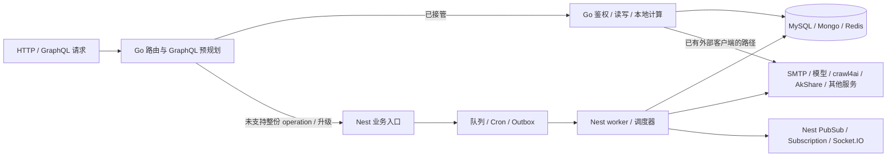

# 开关、执行所有权与复用入口

[入口](README.md) · [缺口](GAPS.md) · [候选](BACKLOG.md)。核对 2026-10-18 14:37–14:42 MSK，源码 `3cedce9aa3200436aba3596f63b559de5490cec8`。这里只记录实际装配与主要链路；各域精确入口、开关名与 Compose 值仍在域页，不抄第二份 HTTP 清单。

## 开关与资源装配

共同事实源：[config.Load](../../../apps/api-go/internal/config/config.go)、[main.run](../../../apps/api-go/cmd/api/main.go)、[wire*](../../../apps/api-go/cmd/api)、[legacyproxy](../../../apps/api-go/internal/legacyproxy)。下表 **A** = DATABASE_URL + JWT_SECRET + REDIS_HOST（含端口/DB/鉴权配置）；**M** = MONGO_URI。A 表示初始化池/客户端/鉴权，不证明网络连通。MySQL Open 是惰性的；Mongo 由使用方按需 Open 并共享，不能用“配置非空”替代启动和真实查询证据。

除最后两行历史例外，HTTP 模式都接受空/legacy/go，空为 legacy、非法值 Load 失败。路由规则和 handler 在本模式 go 时添加；精确 METHOD/路径以域页对应 With* 为准，未知路径/方法仍 Nest。命中 ModeGo 但找不到 handler 返回 **501**，不会自动回退；业务服务错误也不会自动转发 Nest。回滚通常改本模式 legacy（onboarding/read 历史例外见末两行）；普通 OPTIONS 回退不是业务依赖。

| 迁移组 / 精确模式名 | 资源与 handler 条件 | 外部/子开关与当前独立条件 |
|---|---|---|
| `API_GO_ACCOUNT_SECURITY_MODE`、`API_GO_AUTH_FACTORS_MODE`、`API_GO_RBAC_MODE` | A；各 wire 只在本模式 go 创建 handler | 不需要登录模式/Mongo；MFA/OIDC 管理不访问 IdP；加密 key 有写时语义，登录未迁 |
| `API_GO_ANALYSIS_VIEWS_MODE`、`API_GO_ANALYSIS_BOARDS_MODE`、`API_GO_ANALYSIS_THREADS_MODE` | A；wireAnalysisCollaboration 共用 Store，分别注册 views/boards+tasks/threads+comments | 业务主体校验和清理不靠另一个开关；可单组启用，LLM/export/worker 不随之启动 |
| `API_GO_NEWS_SOURCES_MODE`、`API_GO_CRAWL_WORKFLOWS_MODE`、`API_GO_CRAWL_PROFILES_MODE`、`API_GO_CRAWL_TEMPLATES_MODE`、`API_GO_CRAWL_FRONTIER_RUNS_MODE` | A；各 wire 与本模式一致 | 管理配置/运行监控，不自动拥有 crawl4ai/BullMQ 的执行；Frontier create/retry 仍 Nest |
| `API_GO_RUNTIME_SETTINGS_MODE`、`API_GO_INFRASTRUCTURE_SETTINGS_MODE`、`API_GO_DATA_RUNTIME_SETTINGS_MODE` | A；各 wire，新建各域 Service/Authenticator/handler | 配置 CRUD 无须 S3/vector/geocode 实网；密钥/内部 token 不是统一启动条件。data-runtime 吞错观察项见 OBS-DATA-001 |
| `API_GO_MODEL_ACCESS_SETTINGS_MODE`、`API_GO_LLM_GATEWAY_PROFILES_MODE`、`API_GO_PROXY_LOAD_BALANCING_MODE` | A；独立 wire，不强开其他两个模式 | 加密 key 与 LITELLM_CONFIG_INTERNAL_TOKEN 为端点读写/内部授权依赖，真实 LiteLLM 应用/探测另算 |
| `API_GO_NEWS_INDICATORS_MODE`、`API_GO_USER_NEWS_BEHAVIOR_MODE`、`API_GO_DASHBOARD_CHARTS_MODE`、`API_GO_HEALTHZ_MODE` | A；charts 也可因 stream go 创建，但不因此接管 charts HTTP | 指标/行为/图表本地读算；ready 的依赖探测按请求执行，不能把 live shadow 计入此组 |
| `API_GO_DASHBOARD_STATS_MODE`、`API_GO_DASHBOARD_WAR_MAP_MODE`、`API_GO_DASHBOARD_WAR_MAP_TRANSPORT_MODE`、`API_GO_DASHBOARD_WAR_MAP_LAYERS_MODE` | A+M；stats.Connect，warMap/transport/layers 共用 dashboardwarmap.Handler | 地理 miss 可能 Nominatim、新闻翻译/实时运输可能外部 HTTP；各组路由独立 |
| `API_GO_DASHBOARD_SPACETIME_GEO_MODE`、`API_GO_DASHBOARD_SPACETIME_PROPAGATION_MODE`、`API_GO_DASHBOARD_STREAM_MODE` | A+M；stream 会构造 charts/warMap/spacetime 的内部服务 | 无须强开它们的 HTTP 模式；stream 是 SSE，未开启 GraphQL/Socket.IO executor；外部边界同地图 |
| `API_GO_CONTENT_SUBSCRIPTIONS_MODE`、`API_GO_USER_DIGEST_MODE` | A+M；wirePersonalNews 按需创建 behavior/catalog/subscription 服务，未开路由不跟随注册 | catalog 可调用 model/vector，digest 可读 ES；投递 scheduler 仍 Nest；不需要先强开 behavior HTTP |
| `API_GO_LLM_LOGS_MODE`、`API_GO_ADMIN_LOGS_MODE`、`API_GO_EXCEPTION_INGEST_MODE`、`API_GO_QUALITY_OVERVIEW_MODE`、`API_GO_CLASSIFICATION_RSS_OPS_MODE` | A+M；各 wire 共享 Mongo | exception ingest 内部 token 在请求时校验；分类报告创建、pipeline 恢复生产者/worker 未迁 |
| `API_GO_NEWSNOW_CLUSTERING_OPS_MODE`、`API_GO_CRAWL_READ_TELEMETRY_MODE`、`API_GO_ITEMS_READING_MODE`、`API_GO_SEARCH_REINDEX_MODE`、`API_GO_SITUATION_MONITOR_SIGNALS_MODE`、`API_GO_PLATFORM_GOVERNANCE_SETTINGS_MODE` | A+M；各 wire/shared Mongo，items HTTP 与其 GraphQL 使用同业务基础 | ES/vector/model 为请求/功能配置依赖，不是所有启动必需；S3 缺口已确认；brief 冷生成候选由 NEWS-BRIEF-001 实现但未合 main，见 GAPS |
| `API_GO_GRAPHQL_ITEMS_LIST_MODE`（本批候选，PR 未合） | A+M；复用 itemsreading Service 与既有 `/graphql` 执行器 | 子开关，go 要求 `API_GO_GRAPHQL_READ_MODE=go` 且 `API_GO_ITEMS_READING_MODE=go`，Load 直接校验；不新增顶层路由/资源 OR |
| `API_GO_SITUATION_MONITORS_MODE` | A；wireSituationMonitors | 自定义 monitor 管理独立于 signals 读；主动 insight/refresh 与 Telegram 登录仍 Nest |
| `API_GO_PUBLIC_PORTAL_MODE` | DATABASE_URL；main 构造 publicportal.NewHandler/MySQLStore，不需要 A 中 JWT/Redis | public org/来源策略与模型配置从 DB；故事 miss 调模型 HTTP，需可用 gateway/密钥但不启动探测 |
| `API_GO_ONBOARDING_MODE`、`API_GO_USER_SETTINGS_READ_MODE` | 任一个 go 需要 A；main 创建读 handler。onboarding 接受空/shadow/go，默认 shadow；read 接受空/shadow/go，默认空；两者均不接受 legacy | read 空时 onboarding 服从 onboarding 模式，rss-reader/spacetime-timeline 默认 shadow，其余 UI GET legacy；read 显式值决定六读 |
| `API_GO_USER_SETTINGS_WRITE_MODE` | 空/legacy/go 默认 legacy；go **要求 read=go**，Load 直接校验；复用同一 read handler/router 的 PUT 分支 | 这是明确子依赖，不是“独立写开关漏接”。只开写且不满足 read 会启动失败；六 PUT 不启动 worker |

GraphQL 精确开关、默认、路由/handler OR、模型与有意义的独立/组合分支集中在 [graphql-runtime](modules/graphql-runtime.md)。main 没有 `API_GO_GRAPHQL_WORKSPACE_WRITE_MODE`；该名称目前只存在 #70，不可把未来模式写成可部署事实。

仓库可见启用：各域 pilot 列保留原始值；[Compose](../../../infra/docker/docker-compose.yml) 的 api-go 是 opt-in profile，CANARY_PERCENT=0，Web 默认指 api:4000。GraphQL 总读/NEWS_EVENTS/KNOWLEDGE_GRAPH 当前未在 api-go environment 显式注入；KG_IMPACT/WORKSPACE_READ/SETTINGS_CRAWL_READ/ORG_ACCESS_WRITE/SETTINGS_WRITE 为固定 legacy。NEWS-BRIEF-001 候选新增 `API_GO_GRAPHQL_NEWS_EVENT_BRIEF_MODE`，本分支的 Compose/.env.sample 固定为 legacy（未合 main 前不是可部署事实）。宿主 .env 设置并不自动覆盖固定值或注入未列变量；须按当时部署入口明确传入，不能只凭变量名存在说可启用。本轮未改配置/未实际部署。

## 产品链路与执行所有权

ITEMS-INGEST-001规划增量（main91e759b4，2026-10-19）：六入口独立写模式需DB/JWT/Redis/Mongo；raw_item定时补偿独立owner模式只需DB/Redis/Mongo，不强开HTTP/READ/JWT。人工写MySQL事务Outbox→即时Mongo→兼容BullMQ producer→水合，采集批写走直接Mongo/CAS/输家清理/逐项入队；不能用一种CRUD代替两条实际路径。producer需新增固定BullMQ5.63.2 standard/priority官方Lua/MessagePack窄adapter，现Go无此能力；stable ProcessedItem/组织计数/事件/marker副作用齐备。Nest itemPipeline worker/计数事件订阅/QueueEvents保留，raw仅后台Cron gate、直接同步调用原CAS。复用itemsreading hydration/投影新port及userdigest公开lease，修hydration专用最新任意状态快照，保持搜索/RSS completed-only不变。详见[提示词](tasks/ITEMS-INGEST-001.prompt.md)，未实现；四订阅contract/exec不触碰，共享接线并集。

GRAPHQL-SUBSCRIPTIONS-001规划增量（main91e759b4，2026-10-19）：默认legacy独立API_GO_GRAPHQL_SUBSCRIPTIONS_MODE拟迁四Subscription传输；鉴权复用authhttp.Identify+policy.Limiter、contract/exec/schema投影与仅模型注册，独立只需DB/JWT/Redis，无READ/Mongo依赖。三域channel为gqlsub:alertEvents/analysisEvents/assistantEvents，Go模式要求bus=redis，producer/业务worker仍Nest。queueEvents独立每进程XREAD bull:itemPipeline:events，不是消费者组，不经gqlsub；job.data→本地cache→queue:pipeline:jobctx:<id>，600秒共享上下文保留终态。新WS executor与HTTP引擎命名空间分离，同连接非本批operation懒建固定Nest WS整份fallback，四本地订阅不依赖其连接。退出先取消hijacked WS/上游socket与专用PubSub/XREAD，再关共享Redis/DB；审计#92、NewsNow、digest公共接线取并集。实现/资源/回滚详见[提示词](tasks/GRAPHQL-SUBSCRIPTIONS-001.prompt.md)，当前未实施。

NEWSNOW-SOURCES-001规划增量（2026-10-19，main91e759b4）：认领两公开source/batch HTTP的实际源getter/运行secret/双缓存/锁/增量提醒；Go尚未实现。拟新增API_GO_NEWSNOW_SOURCES_MODE默认legacy，双端校验/注入，Go只需DB+Redis，不强开JWT/Mongo/旧ops。fresh/stale键和物理refresh锁与Nest兼容；来源secret全局单例只读，不改CRUD权限。Nest进程内dispatcher/active registry需要新newsnow:source-refresh:v1专用relay，按真实认证订阅org选目标，adapter启用时以(refreshId,orgId)60秒NX标记防重复跨实例广播、关闭时各实例本地广播；不建耐久事件平台。Nest source-warm每分钟并发6与hottest每10分钟Cron保持唯一后台所有权，仍调用Nest fetchSource；本批不迁cron/BullMQ/通用WS，不能由HTTP接管宣称停Nest。详见[完整提示词](tasks/NEWSNOW-SOURCES-001.prompt.md)。

AUDIT-OUTBOX-001规划增量（2026-10-19，main c70b0373）：审计producer已在多个Go域及Nest使用同一MySQL AuditLogOutbox协议，当前消费仍Nest；新任务仅认领此消费者与双端gate，未实现。拟新增API_GO_AUDIT_OUTBOX_MODE默认legacy、双端非法值失败；go仅需DB+Redis、不强开HTTP/JWT/Mongo。物理锁lock:cron:audit-log-outbox，PX55000、token续租/释放；每分钟200、并发8、5分钟stale与10次dead保持。复用userdigest.NewRedisDeliveryStore的公开端口与现有sharedDB/Redis，不迁摘要业务；SCHEDULE_ENABLED=false停本链。先停旧owner/drain再启Go，回滚反向；RawItem/Cleanup/retention等保持Nest。详见[提示词](tasks/AUDIT-OUTBOX-001.prompt.md)，不把其他异步链标完成。

RSS-TRANSLATION-001规划增量（main90765633，2026-10-18）：同步Mutation内由Go选本租户最新processeditems→四字段/Markdown分块→外层7天缓存→DeepLX主备/LLM→内层DeepLX30天缓存→指标原子upsert/逐attempt模型日志。无入队/worker/Cron，无原文/索引写回；默认legacy新独立写模式，不强开旧items读或网关管理HTTP。itemsreading runtime私有需新窄端口，BriefCompleter固定简报JSON不能直接复用；publicportal新RSS端口选择复用配置/治理/协议helper，llmlogs新writer不碰#81变动helper。status不得回填窄profile污染llm_gateway:profiles，详见GAP-RSS-001。外部未验证，具体边界见任务/提示词；摘要投递与其runtime/notifications文件所有权保持。

DIGEST-DELIVERY-001规划增量（main90765633，2026-10-18）：仅认领摘要Cron/生成/SMTP/结果与通知完整链，无BullMQ。Go已有GenerateDigest、authlogin.NewMailSender；digest独立构造与runtime公开窄读取端口需本批补，不能假定已存在。tick NX EX55、组织锁实际lock:cron:user-digest-delivery:org:<orgId> PX55000并自动续租/比较token。拟新增API_GO_USER_DIGEST_DELIVERY_MODE同时注入Go/Nest，默认legacy；go下Nest旧Cron在tick gate前退出、仅保留本批摘要通知relay和已有Socket.IO。relay通道拟新增user-digest:notifications:v1，写Notification后发布ID，Nest按租户重读、仅发本实例匹配socket，避免Redis adapter多次广播；未实现/未实网验证。delivery-only独立需DB/Redis/Mongo/SMTP，不强开HTTP或JWT；切换先停Nest并drain再启Go，回滚先停Go并drain再恢复Nest。其他调度/四Subscription/Outbox所有权不变。

| 链路 | Go 已拥有 | Nest 仍拥有 / 外部边界 | 下一步前置 |
|---|---|---|---|
| 登录与权限 | authn JWT 验签/Redis 撤销、authz membership/permissions；账户/MFA 配置管理 | [AuthService](../../../apps/api/src/modules/auth/auth.service.ts) 登录/refresh/代码/MFA 登录完成；PasswordReset/OrgInvite/RegistrationApplication/OidcAuth 与 EmailService/IdP | token/session/cache 协议与已迁 logout/密码变更保持一致；先 BL-04，再邀请/审批/OIDC |
| 条目检索 | REST List/Detail、GraphQL item/facets/RSS、local/ES/vector recall、reindex goroutine | [ItemsService](../../../apps/api/src/modules/items/items.service.ts) create/update 与 RawItemOutbox、queue processor/流水线更新 read-model；ES/vector/model 是外部 | BL-05 只补查询；写/导入须和 raw→processed/read-model/index 副作用一起定界 |
| 设置→运行器 | runtime/settingswrite 配置规范化、MySQL+共享 Redis、审计/失败 outbox | [NewsPipelineService](../../../apps/api/src/modules/news-pipeline/news-pipeline.service.ts)、采集/新闻/KG/实时/邮件调度读取配置后执行 | 不把配置保存算运行器迁移；Outbox 消费唯一执行者单独切 |
| 事件 brief | GraphQL 缓存命中；publicportal 独立实现同步生成/写回 | GraphQL brief 冷路径 Go 缺失；模型是外部服务，不是必须回 Nest 的理由 | BL-02 抽取/复用私有能力前明确 DTO/参数差异 |
| 归档 | dataruntimesettings配置/状态；部分Go规则词典/国家识别、publicportal来源、llmembed/vector transport/analysisexport复用 | ArchiveService查询/显示资格/缓存分类、搜索embedding/vector/rerank；queue service ensure*Coverage；processor分类/信号回填/状态推进。getDetail本身无翻译/分类冷生成 | ARCHIVE-READING-001 reserved：三Query+search整路、Go兼容producer→Nest唯一consumer；新archive_port/vector_port，不依赖未落main的pipelineenqueue；worker第二阶段未认领，不能关闭整链 |
| 分析/Assistant | history 查询、运行能力配置；协作工作区 CRUD | [AnalysisService](../../../apps/api/src/modules/analysis/analysis.service.ts) submit*→Mongo→analysis queue→process→通知/事件；[AssistantService](../../../apps/api/src/modules/assistant/assistant.service.ts) submit*/process/工具/模型 | 核实 job payload、重试与流式 chunk；选择明确仍由 Nest 消费的阶段或完整 Go 执行器，禁止只有 pending 记录 |
| 告警 | 历史/channel/replay/tuning 读取；8交互写仍在 #70 | [AlertsService](../../../apps/api/src/modules/alerts/alerts.service.ts) ensureDefaultRules、规则 CRUD/trigger、评估/投递；[AlertsProcessor](../../../apps/api/src/modules/alerts/alerts.processor.ts)，SMTP/webhook | BL-10 等 #70 共享模型稳定；交互配置不等于扫描/投递迁移 |
| 采集 | source/workflow/profile/template 管理、Frontier 状态/取消、task/results/media 读（S3 除外） | CrawlService→BullMQ→CrawlQueueProcessor、Frontier 发现/入队、crawl4ai、ingest/outbox/清理；metadata 也主动网络 | 分元数据、task 写/ingest、Frontier dispatch、queue 控制；先固定 payload/事务/存储所有权 |
| 经济与图谱 | economic 历史/统计、knowledgegraph/kgimpact 图与证据队列查询 | [AkshareService](../../../apps/api/src/modules/akshare/akshare.service.ts) ensureRepeatableJobs 与 processor；KG ingestion/review，新闻事件/指标 ingestion Cron；AkShare/模型外部 | 配置更新要同步 repeat，review 要同步边/证据与聚合；不能只保存配置/状态 |
| 态势/实时 | monitor 管理、Telegram/Oref/refresh 状态缓存读、feedback；地图已有部分直连外部能力 | [signals processor](../../../apps/api/src/modules/situation-monitor/signals/situation-monitor-signals.processor.ts)、external-snapshot Cron、RealtimeSignalsService、Telegram/Oref polling/登录 | 先识别全局缓存与租户过滤、collector 唯一租约；新增 Go 读不会刷新这些缓存 |
| digest / 审计与清理 | delivery 设置/预览与 AuditLog/失败 Outbox 生产者 | [delivery scheduler](../../../apps/api/src/modules/user-digest/user-digest-delivery-scheduler.service.ts)、AuditLogOutboxService、RawItemOutboxService、CrawlCleanupOutboxService | 核对去重、租约、失败补偿；迁消费者前不能停 Nest Cron |
| 实时传输 | dashboard SSE；Go GraphQL preflight/投影执行 | [graphql-subscriptions](../../../apps/api/src/modules/graphql-subscriptions) Redis backplane，4 Subscription executor；[websocket](../../../apps/api/src/modules/websocket) Socket.IO | Redis 作为 transport 已支持不代表 executor 迁移；保持事件 schema/租户/权限，独立切传输 |
| vector | vector-go 三 HTTP→Qdrant，api-go 有 vector recall 客户端 | 上游配置/真实部署去向未知，独立 vector Nest 仍可服务 | BL-22 先查配置优先级与部署证据；不重复开发已有算法 |

## 可复用能力索引

第三批 items 专项（main 9d0462e1）：ITEMS-LIST-001 拥有 itemsreading/graphql adapter 完整列表及最小 contract/exec 只读选择元数据；`newsbehavior.GetPersonalizationProfile` 可复用 positive/negative，`llmembed.Rerank` 有现成 HTTP/profile 但本链路需补 timeout/attempt/日志观测表面。现有 REST List 不是完整列表实现，候选融合不是最终相关性排名。新子开关复用 READ+ITEMS 父资源，不需要新顶层接管；不碰简报的 publicportal/llmlogs 或存储的依赖清单。

S3 专项认领（2026-10-18，main 9d0462e1）：STORAGE-MEDIA-001 拥有 infrastructuresettings 运行配置导出、objectstorage 窄包、媒体及两处详情 service 注入和 storage/test；现有 storage:settings/cache/crypto 可复用，S3 客户端原先没有。新诊断 HTTP 模式只需 DB/auth/Redis，不依赖 Mongo 或其他 HTTP 模式；媒体 REST/GraphQL 沿原开关。只有诊断写/删自己的测试对象，无队列/worker 所有权；BL-15 其余诊断未认领，NEWS-BRIEF-001 客户端文件不重叠。

NEWS-BRIEF-001 增量（main 9d0462e1，2026-10-18）：本批拥有 publicportal 简报 completion 最小导出表面（`BriefCompleter`/`BriefCompletionRequest`/`BriefCompletionResult`/`BriefCompletionObserver`/`NewBriefCompleter`）与 llmlogs 新增 typed completion writer；既有 `Service.brief`、`completionRequest`、gateway helper 原先私有，日志 writer 原先不存在。复用父 GraphQL 读的 sharedDB/JWT/Redis/共享 Mongo，不依赖 `PUBLIC_PORTAL_MODE`、`LLM_LOGS_MODE`、gateway 配置管理 HTTP 模式或任何写模式；模型配置懒加载，不在启动探测真实模型。默认/Compose 均为 `API_GO_GRAPHQL_NEWS_EVENT_BRIEF_MODE=legacy`，实际部署未切换；任务无 BullMQ/cron 执行权，模型调用与日志/缓存写回都在同步请求链路上。

所有位置按页首 SHA。包内小写符号是 **私有**，不能在新包直接调用；需要抽取时先写清所有权和副作用。返回模型共享不代表业务权限可以复用成同一根权限。

S3 专项交付（2026-10-18，业务 PR #73，基线 main 9d0462e1）：STORAGE-MEDIA-001 拥有 `infrastructuresettings.StorageRuntimeConfig`（复用九键、storage:settings 60 秒缓存与回退、明文/加密密钥解密）、新窄包 `internal/objectstorage`（具名 RuntimeConfig/ReadURLOptions + AWS SDK v2 s3/credentials/smithy-go 的 client/presign/HeadBucket/PutObject/DeleteObject，显式静态凭据、不启用默认凭据链或 IMDS）、crawlreadtelemetry 媒体与详情接入、settingscrawl.Options.StorageConfig 注入、独立诊断开关 `API_GO_STORAGE_DIAGNOSTICS_MODE`。对象存储依赖经既有 CI `go-modules-regen` 远端生成，本机不安装。只有诊断写/删自己每次唯一的测试对象；媒体 presign 不 HEAD、不下载；无队列/worker 所有权。BL-15 其余诊断仍未认领。

| 能力 | 真实 Go 入口 / 路径 | 使用限制与副作用 |
|---|---|---|
| 鉴权/租户 | [authn](../../../apps/api-go/internal/authn) Verifier、RedisBlacklist；[authz](../../../apps/api-go/internal/authz) MySQLRepository；[authhttp](../../../apps/api-go/internal/authhttp) NewAuthenticator | JWT 后从 DB 重推导 membership/permissions；机器令牌是否允许由 HTTP/GraphQL 分别决定，不能信任请求 orgId |
| GraphQL 写与预规划 | [contract.go](../../../apps/api-go/internal/graphqlread/contract/contract.go) Registry.RegisterMutation/Bind/RegisterType/RegisterFieldPermission；[exec](../../../apps/api-go/internal/graphqlread/exec) Engine.PlanDocument/Execute | root 重复 panic；RegisterType 会覆盖类型映射，不是类型兼容检查器；先 plan 所有选中字段再写；模型不自动携带授权 |
| 身份/组织模型与业务 | [workspace.RegisterModels](../../../apps/api-go/internal/graphqlread/workspace/register.go)、[rbacapi](../../../apps/api-go/internal/rbacapi) AssignRoleView/UpdateMembershipRolesView/SetUserActiveView | 模型注册带字段权限；rbac 方法有事务、角色提升限制与缓存失效，别只复用 SQL 片段 |
| 条目读取/检索 | [itemsreading.NewService / Service.List / Detail](../../../apps/api-go/internal/itemsreading/service.go)、Facets/ResolveEventID；graphqlread/itemsreading 适配器 | DB/Mongo/Redis，ES/vector/embedding 配置与回退；List 是 REST RECENCY 入口，不是 GraphQL 全排序实现，不能用它直接宣称 `items` 完成 |
| 查询规范化 | [analysiscollab/query.go](../../../apps/api-go/internal/analysiscollab/query.go) NormalizeQueryString/BuildQueryState/ReadQueryState | 可用于导出解析的基础；不包含导出全量拉取/CSV/归档模式；私有参数 helper 不能跨包直调 |
| 设置规范化/模型 | [settingscrawl/writesupport.go](../../../apps/api-go/internal/graphqlread/settingscrawl/writesupport.go) 导出的 Default*/Normalize*/AssertSystemAdmin；RegisterSettingsModelTypes | 只是 model/normalizer，不自行持久化；返回嵌套类型须注册。SystemSetting/Redis key/TTL 与 Nest 共享 |
| 设置存储/共享缓存 | [runtimesettings](../../../apps/api-go/internal/runtimesettings)、[settingswrite/store.go](../../../apps/api-go/internal/graphqlread/settingswrite/store.go) upsertSetting/cacheSet/writeAuditLogBestEffort | 后者 helper 私有；best effort 审计失败写 AuditLogOutbox，重放仍 Nest；不能把 DB+Redis 审计都视为原子事务 |
| 告警/通知模型 | [alerts/register.go](../../../apps/api-go/internal/graphqlread/alerts/register.go)、[history/register.go](../../../apps/api-go/internal/graphqlread/history/register.go)、workspace.RegisterModels | main 基线 alerts/history 的 Register 同时加 Query；#70 才拆 RegisterModels。新任务不能引用 PR 中尚未合入的导出函数 |
| 简报与模型 HTTP | [publicportal/story.go](../../../apps/api-go/internal/publicportal/story.go) Service.brief、[gateway.go](../../../apps/api-go/internal/publicportal/gateway.go) gatewayClient.Complete；[llmembed](../../../apps/api-go/internal/llmembed) NewClient | 简报 helper/request 私有；有配置/密钥解密/模型 HTTP，非现成 GraphQL 通用服务；llmembed 只表示 embedding/rerank 能力，不能替代 chat completion |
| 存储配置与签名媒体 | [infrastructuresettings/storage.go](../../../apps/api-go/internal/infrastructuresettings/storage.go)、[crawlreadtelemetry/service_media.go](../../../apps/api-go/internal/crawlreadtelemetry/service_media.go) verifySignedAssetAccess/getAssetDeliveryPayload | 两处主要 helper 私有；前者配置管理/解密不等于 S3 对象签名客户端；后者仅 MySQL 下发完整，见 GAP-CRAWL-001 |
| 数据/序列化 | contract.FormatDateTime；[history/runs.go](../../../apps/api-go/internal/graphqlread/history/runs.go) findRuns/map*；[economic/query.go](../../../apps/api-go/internal/graphqlread/economic/query.go) load/queryPoints | UTC 毫秒契约；history/economic reader 私有，业务 JSON 强类型要求继续适用，不能把通用协议 any 搬进新 DTO |
| Go 后台本地任务 | [searchreindex/service.go](../../../apps/api-go/internal/searchreindex/service.go) startReindex/runReindex/reindexOrg、Close | 私有、Redis job 状态+goroutine；不是 BullMQ 协议库，重启不自动恢复；不可直接用来迁其他 queue |
| vector-go | [httpapi.New](../../../apps/vector-go/internal/httpapi/server.go)、[qdrant.Client](../../../apps/vector-go/internal/qdrant/client.go) UpsertPoints/Search | 独立进程 HTTP/内部 token、orgId 过滤；上游调用地址另由配置选择，不跨服务 import 内部包 |
